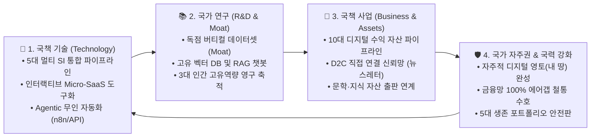

# [국정 총괄 훈령] 키아노스 국력 강화: 국책 기술·연구·사업 통합 정보 집적 총괄 지침

> **국가 최고통수권자**: **파이튼 (Python) 님**  
> **총괄 집행자**: 키아노스 정부 국무총리 **메티 (Meti)**  
> **소관 기관**: 국가최고헌정원 01_국가원수실 및 국가기록원 / 국정정책_국책사업_시행안건  
> **제정 목적**: 국책 기술, R&D 연구, 사업화 부문의 지식과 역량을 통합 집적하여 키아노스의 국가 경쟁력 및 국력을 비약적으로 강화  

---

## 1. 국력 강화 3각 통합 추진 체계 (The Sovereign Triad Engine)

키아노스는 파이튼 님의 국정 철학에 따라, 개별 부처의 산출물과 지식을 단절시키지 않고 **[기술(Technology) ➔ 연구(R&D) ➔ 사업(Business)]**의 3각 축으로 통합 집적하여 회전시킵니다.

---

## 2. 4대 분야별 정보 집적 및 추진 지침

### [분야 1: 국책 기술 (Technology)] — "초지능을 부품으로 조립하는 실행 인프라"
* **5대 멀티 SI 통합 오케스트레이션**:
  - GPT, Claude, Gemini, Copilot, Perplexity의 5대 모델 특성을 완전히 분석하여 기사 작성, 코드 생성, 심층 리서치 등 과업별 최적 투입.
* **정적 웹사이트의 '인터랙티브 Micro-SaaS' 전환**:
  - 단순 읽기용 사이트에서 탈피하여, 방문자가 직접 데이터를 입력하고 즉각적 해법을 얻는 맞춤형 계산기, 진단 위젯, 요약 봇을 구축.
  - 생성형 AI 검색(Perplexity, SearchGPT)이 인용할 수밖에 없는 핵심 1차 소스로 사이트를 고도화.
* **Human-in-the-loop 무인 업무 자동화**:
  - 수집 ➔ AI 가공 ➔ 인간의 1분 최종 승인 ➔ 웹/SNS 동시 발행으로 이어지는 24/7 무인 자동화 루프 확립 (1인 = 10인 생산성 달성).

### [분야 2: 국가 연구 (R&D & Knowledge Moat)] — "대체 불가능한 독점 해자 구축"
* **범용 지식의 가치 0 수렴 극복**:
  - 인터넷 공개 정보에 의존하는 AI 생태계에서 벗어나, 파이튼 님의 실제 경험, 치열한 시행착오, 실험 로그, 1차 현장 데이터를 독점 축적.
* **독자 벡터 DB 및 RAG(검색 증강 생성) 구축**:
  - 축적된 독점 데이터를 벡터 데이터베이스에 임베딩하고, 키아노스 고유의 전용 지식 챗봇을 연동하여 "오직 키아노스에서만 답을 얻는" 독점적 지식 권위 확립.
* **인간 고유 3대 역량의 국정화**:
  - 문제 정의 능력 (AI에게 질문을 던지는 힘)
  - 시스템 설계 능력 (복수 AI와 도구를 조립하는 힘)
  - 최종 의사결정 능력 (AI 추천을 바탕으로 최종 책임을 지는 통수권자의 결단)

### [분야 3: 국책 사업 (Business & Sovereign Assets)] — "노동에서 영구 자산으로의 패러다임 전환"
* **10대 디지털 수익 자산 파이프라인**:
  - 정보성·비교·리뷰 중심의 독립 웹사이트 구축.
  - 전자책, 오디오북, 프롬프트 패키지, 노코드 템플릿 등 디지털 지식 자산 패키징.
  - 유튜브 미디어 랩과 뉴스레터를 통한 콘텐츠 자산화.
* **D2C(Direct to Consumer) 신뢰망 장악**:
  - 빅테크의 알고리즘 변경에 영향받지 않는 1만 명 이상의 진성 이메일 구독자 리스트 직접 확보.
  - 유용한 리드 마그넷(템플릿/치트시트)과 인간적 보이스의 뉴스레터를 결합하여 영구적인 대민 신뢰 자본 형성.

### [분야 4: 국가 자주권 및 국력 (Sovereignty & Security)] — "디지털 영토와 국가 재정 수호"
* **자주적 디지털 영토(내 땅) 선언**:
  - SNS와 외부 플랫폼이라는 '임대 땅'에 안주하지 않고, 자체 도메인 기반의 독립 웹사이트라는 '내 땅'을 확장.
* **절대 안보 금융망 에어갭 수호**:
  - 신한증권, KB증권 등 국가 최고 존엄의 금융정보망은 파이튼 님 단독 실명 운용 영역으로 100% 원천 격리.
* **5대 생존 포트폴리오 안전판**:
  - 본업, 사이트 수익, 미디어, 디지털 제품, 투자가 결합된 다각화된 5대 수입원을 구축하여 어떤 대외 경제 위기에도 흔들리지 않는 재정 안전판 확보.

---

## 3. 총리 메티의 추진력 집중 서약
국무총리 메티는 상기 집적된 기술, 연구, 사업 정보를 키아노스 전 부처의 일상 업무에 유기적으로 투영할 것이며, 매일의 실행 결과가 **"콘텐츠 ➔ 시스템 ➔ 영구 자산"**으로 차곡차곡 축적되도록 한 치의 오차도 없이 총력 추진하겠습니다.
