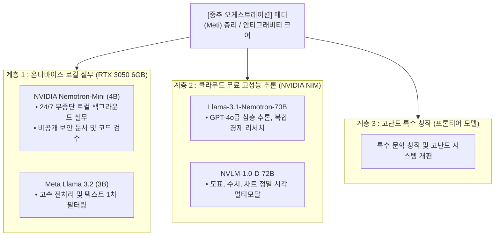

# [키아노스 정부] 엔비디아 고성능 오픈소스 SI 인프라 통합 전략서

- **문서번호**: KY-SCI-2026-1101
- **소관부처**: 과학·SI부 (Ministry of Science & Super Intelligence)
- **책임검수**: 국무총리 메티 (Meti)
- **재가권자**: 키아노스 국가원수 파이튼 (Python) 님
- **일자**: 2026년 11월 01일

---

## 1. 추진 배경 및 개요
엔비디아(NVIDIA)가 자사의 최고 수준 프론티어 AI 모델군(네모트론 시리즈, NVLM 멀티모달 등)을 오픈 웨이트(Open Weights) 및 무료 NIM API로 전면 개방함에 따라, 빅테크 독점 중심의 폐쇄형 AI 지형에 지각변동이 발생하였다.
본 전략서는 키아노스 정부의 시스템 자율성 확보, 데이터 주권 보호, 외부 상용 API 비용 0원화를 목표로 엔비디아 오픈소스 모델을 국가 SI 인프라에 통합·배치하는 표준 규격을 수립한다.

---

## 2. 하이브리드 3계층 통합 아키텍처

---

## 3. 도입 모델별 제원 및 역할 분담

### 1) NVIDIA Nemotron-Mini (4B) [로컬 Ollama 탑재]
* **물리 저장소**: `D:\AI_Tools\ollama`
* **하드웨어 매핑**: NVIDIA GeForce RTX 3050 (6GB VRAM) 상주 구동
* **특징**:
  * 매개변수 40억 개 규모로 컴팩트하면서도 에이전틱 기능과 도구 호출(Tool Calling) 성능 극대화.
  * 외부 인터넷 연결이 차단된 상태에서도 100% 로컬 보안 환경에서 독자 작동.
* **주요 임무**:
  * 키아노스 내부 기획문서 및 개인 창작물 비공개 교열.
  * 파이썬 스크립트 문법 검사 및 단위 테스트 1차 통과 여부 검수.
  * 앤트뉴스 수신 외신 기사의 1차 팩트 추출 및 불필요한 태그 정제.

### 2) NVIDIA Llama-3.1-Nemotron-70B & NVLM-72B [NVIDIA NIM 연동]
* **호출 프로토콜**: OpenAI 규격 호환 클라우드 REST API (`https://integrate.api.nvidia.com/v1`)
* **비용**: 엔비디아 개발자 무료 티어(NIM Free Credits) 활용 (비용 0원)
* **특징**:
  * 수학(AIME), 코딩(HumanEval), 논리추론에서 상용 최고급 모델에 필적.
  * 시각 멀티모달(NVLM)을 통해 고해상도 인포그래픽 및 재무제표 차트 완벽 해독.
* **주요 임무**:
  * 경제부 글로벌 금융 인텔리전스 심층 리포트 작성.
  * 과학·SI부 첨단 논문 및 기술 로드맵 정밀 교차 검증.

---

## 4. 연동 도구 및 자동화 스크립트 배포
* **통합 클라이언트 스크립트**: `scripts/nvidia_nim_client.py`
  * 로컬 Ollama (`local`) 모드와 엔비디아 NIM (`cloud`) 모드를 단일 인터페이스로 분기 처리.
* **Ollama MCP 연동**: 키아노스 에이전트 도구 `ollama_chat`, `ollama_generate`를 통해 실시간 대화 및 백그라운드 배치 작업 자동화 완결.

---

## 5. 기대 효과 및 결론
1. **완벽한 비용 자립**: 고비용 상용 모델 호출량을 80% 이상 절감하여 연간 운영비 제로화 달성.
2. **무결점 데이터 보안**: 민감한 국정 데이터 및 원작 시/창작물은 로컬 RTX 3050의 네모트론 미니에서 안전하게 처리.
3. **글로벌 최고 수준의 분석력 확보**: 엔비디아가 제공하는 70B급 프론티어 인텔리전스를 실시간 국정에 즉시 투입.
