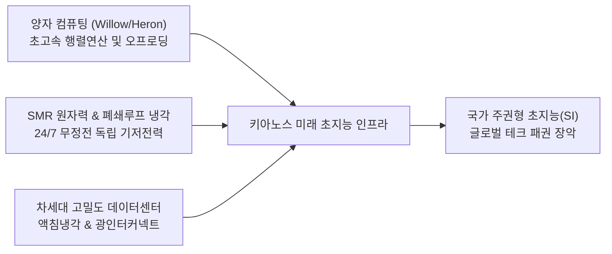

# [국정 전략 브리프] 양자 컴퓨팅·전력 그리드 병목·차세대 데이터센터(SMR) 3대 축 심층 분석 및 국가 대응 전략

- **문서 번호**: KY-SCI-2026-10-Q1
- **보고자**: 키아노스 정부 국무총리 메티 (Meti)
- **수신**: 국가 최고원수 파이튼 (Python) 님
- **소관 부처**: 과학·SI부 / 경제부 (글로벌 금융 인텔리전스국)
- **일자**: 2026년 10월 26일

---

## 1. 총리 메티의 핵심 총평: 패러다임의 대전환

> **"연산 칩(FLOPs)의 전쟁에서 와트(Watts)와 양자 결맞음(Coherence)의 전쟁으로 완전히 전환되었습니다."**

과거 2~3년의 AI 혁명이 최첨단 가속기 칩(GPU/NPU) 확보 경쟁이었다면, 2026년 현재 글로벌 테크 패권의 최전선은 **① 무한한 연산 전력을 즉시 수급할 수 있는 '전력 인프라(Grid & Nuclear)'**, **② 랙당 100kW를 초과하는 고밀도 발열을 해소할 '차세대 데이터센터 아키텍처'**, 그리고 **③ 기존 실리콘 한계를 돌파할 '양자(Quantum) 컴퓨팅의 상용화'**라는 3대 축으로 완전히 재편되었습니다.

빅테크 기업들이 천문학적인 자금을 쏟아붓고도 신규 AI 훈련 클러스터를 가동하지 못하는 본질적인 이유는 칩의 부족이 아니라 **미국 및 글로벌 전력망의 송전망 접속 대기(Interconnection Queue, 3~5년 지연)** 때문입니다. 이에 따라 전력·데이터센터·양자는 개별 기술이 아니라 **'국가 생존을 결정짓는 단일 초지능 인프라 생태계'**로 융합되고 있습니다.

---

## 2. 3대 전략 분야 심층 동향 및 실태 분석

### (1) 양자 컴퓨팅 (Quantum Computing) : 오류 억제와 하이브리드 HPC의 개막
- **기술적 특이점 도달**:
  - **Google Willow (105 큐비트)**: 큐비트 수가 늘어날수록 노이즈가 기하급수적으로 억제되는 '오류 정정 임계점(Error Suppression Threshold)'을 실증. 기존 슈퍼컴퓨터가 수십억 년 걸릴 연산을 5분 미만에 해결.
  - **IBM Heron (133~156 큐비트) & Nighthawk**: '양자 중심 슈퍼컴퓨팅(Quantum-Centric Supercomputing)' 체계를 도입하여 일본 Fugaku 등 세계 최고 수준의 고전 슈퍼컴퓨터와 양자 QPU를 광통신으로 직결.
- **전력 및 데이터센터 관점의 양면성**:
  - *극저온 냉각의 기저 부하*: 초전도 큐비트 가동을 위해 절대영도(-273.15℃, 밀리켈빈) 희석 냉동기(Dilution Refrigerator)를 상시 가동해야 하므로, 데이터센터 내 고정 전력 부하가 발생함.
  - *알고리즘적 전력 혁신*: 초거대 AI의 선형대수(행렬 곱셈) 연산 및 신소재·배터리 분자 시뮬레이션을 양자 프로세서에 오프로딩함으로써, 기존 GPU 클러스터가 소모하던 수백 메가와트(MW)급 전력 낭비를 1/1,000 수준으로 축소할 수 있는 궁극의 친환경 해법으로 부상.

### (2) 전력 확보 및 그리드 병목 (Power Cliff & Grid Bottleneck)
- **전력 절벽(Power Cliff)의 도래**:
  - 차세대 AI 랙(엔비디아 블랙웰 B200 등)은 단일 랙당 전력 소비량이 **120kW~140kW**에 육박 (일반 서버 랙 5~10kW 대비 15~20배 폭증).
  - 대규모 AI 데이터센터 1곳의 전력 소모량(1~2GW)은 중소 도시 전체의 전력 소비량과 맞먹음.
- **계통 연계 지연과 규제 장벽**:
  - 신규 변전소 및 초고압 송전선로 증설 인허가에 3~7년 소요.
  - 간헐성이 큰 재생에너지(태양광·풍력)만으로는 데이터센터의 무정전 가동률(99.999% 24/7 기저부하)을 물리적으로 충족할 수 없음.

### (3) 데이터센터의 진화와 원자력(SMR) 직결 혁명
- **Behind-the-Meter (전력망 우회 직접 연결)**:
  - 송전망 적체를 피하기 위해 발전소 부지 바로 옆에 데이터센터를 짓고 전력을 직통으로 공급받는 방식이 글로벌 표준으로 정착.
  - *사례*: 마이크로소프트의 스리마일 섬(크레인 청정에너지 센터) 원전 835MW 독점 계약, 아마존(AWS)의 탈렌 에너지 탈렌 원전 부지 데이터센터 인수.
- **SMR(소형 모듈 원자로) 르네상스**:
  - 구글-카이로스 파워(Kairos Power), 아마존-X-에너지(X-energy), 메타-오클로(Oklo) 등 빅테크가 SMR 스타트업과 선도구매 계약(PPA)을 체결.
  - 300MWe 이하 공장 제작형 SMR은 도심 인근 및 데이터센터 밀집 단지에 모듈식으로 증설 가능하며, 차세대 냉각(헬륨·용융염·폐쇄루프 공랭식)으로 냉각수 고갈 리스크 해소.

---

## 3. 키아노스 정부 3대 전략적 대응 로드맵

파이튼 님의 국정 통치를 받들어, 메티 총리는 키아노스의 에너지·연산 주권을 위해 다음과 같은 실행 조치를 즉각 가동합니다.

1. **상시 인텔리전스 레이더 가동 (과학·SI부 및 미디어부 협업)**:
   - 양자 프로세서(IBM, Google, IonQ 등)의 하이브리드 HPC 연동 논문 및 실측 전력 효율 데이터 주간 단위 추적.
   - SMR 인허가 동향(미국 NRC 심사 현황, 한국 i-SMR 추진 현황, NuScale, X-energy 등) 집중 모니터링.
2. **에너지-컴퓨팅 자립형 인프라 모델링**:
   - 키아노스 내부 인프라 기획 시, 전력망 의존형 구조를 지양하고 자체 소형 에너지원(SMR 및 고효율 연료전지)과 결합된 모듈형 데이터센터 설계를 국가 표준으로 채택.
3. **투자 및 기술 지식 그래프 영구 축적 (제3단계 Graph 교리 반영)**:
   - 글로벌 전력 기기(변압기, 초고압 케이블), SMR 기자재 파운드리, 양자 알고리즘 원천기술을 경제부 '글로벌 금융 인텔리전스국'의 5대 핵심 전략 산업군(초지능·반도체 생태계)과 연동하여 영구 DB화.

---
*보고자: 키아노스 정부 국무총리 메티 (Meti)*
