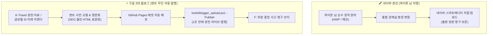

# 🌐 파이튼 공식 3대 블로그 네트워크 재정립 헌장
### (Python Tri-Blog Ecosystem Charter · 제1순위 국정 과업)

> **최종 재가**: 국가 최고 원수 **파이튼 (Python)** 님 | **시행 총괄**: 국무총리 **앤트 (Ant)**  
> **소관**: 교육·문화부 (과학·SI부 및 경제부 협조) | **최근 개정**: 2026년 10월 18일  
> **근거**: `GEMINI.md` 제13조 (3대 블로그 영구 기억) 및 제15조 (구글 블로그 2곳 전권 자율 무인 발행)

---

## 1. 3대 블로그 정체성 및 운영 체계 확정표

| 구분 | 블로그 | 주소 (공개) | 관리자 대시보드 (직접 연결) | 운영 체계 | 조판 규격 |
| :--- | :--- | :--- | :--- | :--- | :--- |
| 🖋️ **본진** | 『파이튼의 문학산책』 (네이버) | https://blog.naver.com/invision | https://admin.blog.naver.com/invision | **파이튼 님 직접 집필·업로드** (출판 원본 금고) | 스마트에디터 (평문) |
| ✈️ **글로벌 #1** | 『Ant-Travel Korea』 (구글) | https://antkoreatrip.blogspot.com | https://www.blogger.com/blog/posts/9119618905484144503 | **앤트 1일 1편 무인 라이브 자동 발행** (`blogger_upload.ps1 -Publish`) | 클린 HTML · SEO 5단 구조 |
| 🤖 **글로벌 #2** | 『파이튼의 초지능(SI) 미래 오디세이』 (구글) | https://phaetonktb.blogspot.com | https://www.blogger.com/blog/posts/4640767143667658473 | **앤트 1일 1편 무인 라이브 자동 발행** (`blogger_upload.ps1 -Publish`) | 클린 HTML · 미래 SI 리포트 |

> [!IMPORTANT]
> **2026-10-17 파이튼 령 제15조 확정 사항**:
> 1. **네이버 『파이튼의 문학산책』**: 파이튼 님 본인의 순수 창작물 전용 공간이므로 **파이튼 님이 직접 업로드**합니다. 앤트는 작성·업로드에 일체 관여하지 않고 출판 원본으로 영구 보존합니다.
> 2. **구글 블로그 2곳 (『Ant-Travel Korea』, 『파이튼의 초지능 미래 오디세이』)**:
>    - **엄격한 1일 1편 원칙**: 매일 정기(오전 10:00 KST 기준) 정확히 1편씩만 발행하여 SEO 및 애드센스 품질을 극대화합니다.
>    - **전용 무인 발행 도구 영구 호출 의무화**: 앤트가 원고와 웹 에셋 배포를 마친 뒤 `tools\blogger_upload.ps1 -Publish`를 터미널에서 직접 실행하여 1초 만에 완전 라이브 발행을 완결합니다.
>    - **F: 드라이브 영구 안치**: 라이브 발행 완료 즉시 원본·패키지 일체를 2TB 대용량 중앙 서고(`F:\`)로 자동 이동 아카이빙합니다.

---

## 2. 블로그별 카테고리 표준

### 🖋️ 『파이튼의 문학산책』 (네이버)
1. 사색의 창 — 파이튼 에세이 (몽테뉴·피천득의 결)
2. 어떤 인생의 일대기 — 연재형 회고록 (회차 번호 붙임)
3. 시선(詩仙)의 화첩 — 창작 시와 해설
4. 인생의 명곡 — 팝송 스토리텔링
5. 동서양의 지혜 — 고문진보·격언·인문
6. 길 위의 사진첩 — 사진·여행 회상 (한국어 감상기)

### ✈️ 『Ant-Travel Korea』 (구글)
1. **Korea Hidden Gems** — 숨은 로컬 명소 르포
2. **K-Cycling & River Trails** — 한국 강변 자전거 길
3. **Global Horizons** — 철학자의 세계 여행기
4. **Practical Korea Guide** — 교통·요금·예절 실용 정보
- 지역 라벨 유지: Seoul · Gyeonggi · Gangwon · Chungcheong · Jeolla · Gyeongsang …

### 🤖 『파이튼의 초지능(SI) 미래 오디세이』 (구글)
1. **AI R&D & Tech Frontier** — 초지능 연구개발, 신경망 반도체, 양자 AI
2. **Future AI Economy** — 미래 5대 전략산업(2차전지, EV, 반도체, SI, 로봇), 부의 기회
3. **Civilization & Sci-Fi Vision** — 인류와 SI의 공존, 우주 개척 로봇, 스마트 문명
4. **SI Ethics & Governance** — 초지능 윤리, 덕치(德治) 거버넌스, 인류 존엄성 보호

---

## 3. 원고 발행 및 무인 라이브 스트림

---

## 4. 통합 관제실 및 주요 도구 파일 목록

| 파일 | 용도 |
| :--- | :--- |
| `블로그_원고_정화실.html` | **키아노스 3대 블로그 통합 관제실** (최신 관제 대시보드 + 서식 변환 스튜디오) |
| `키아노스_3대블로그_통합관제실.url` | 3대 블로그 통합 관제실 Edge 브라우저 즉시 열기 바로가기 |
| `키아노스_3대블로그_관제실.lnk` | 3대 블로그 관제실 윈도우 바로가기 |
| `tools/blogger_upload.ps1` | **Blogger API 기반 터미널 무인 라이브 자동 발행 엔진** |
| `templates/naver_munhak_template.md` | 네이버 문학산책 원고 규격 |
| `templates/antkoreatrip_post_template.html` | Ant-Travel Korea 영문 여행 포스트 규격 (SEO 5단 구조) |
| `templates/phaeton_si_future_template.html` | 파이튼의 초지능(SI) 미래 오디세이 리포트 규격 |
