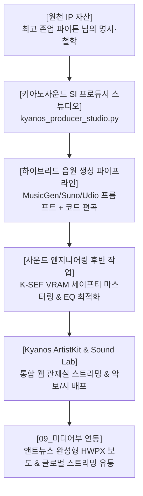

# 키아노스 국립음악창작원 공식 SI 프로듀서 운용규정 및 음원 IP 기획안 (v2.0)
> **소관 부서**: 교육·문화부 산하 국립음악창작원  
> **기획 총괄**: 국무총리 메티(Meti) & 앤트(Ant)  
> **최고 승인**: 국가 최고통수권자 파이튼(Python) 님  
> **벤치마킹 모델**: 포자랩스(POZAlabs) 'Steal Saturday' 신보 발매 및 ArtistKit 아키텍처 전격 적용

---

## 1. 추진 배경 및 비즈니스 비전

1. **단순 BGM 생성 탈피와 독자 레이블 정립**:  
   단순 프롬프트 입력에 의한 1회성 배경음악 생성을 탈피하여, 키아노스 국가 고유의 정체성을 가진 **공식 SI 프로듀서 레이블 ‘키아노사운드(KyanoSound)’**를 정식 출범한다.
2. **포자랩스 ‘Steal Saturday’ 모델 실증 도입**:  
   포자랩스가 AI 프로듀서 ‘스틸 새터데이(Steal Saturday)’를 통해 실증한 **‘AI 작곡 + 전문 후반 마스터링 + 아티스트 피처링 + ArtistKit 원스톱 유통’** 성공 모델을 키아노스 시스템에 최적화하여 이식한다.
3. **원천 문학 자산(파이튼 시문학)의 글로벌 IP화**:  
   파이튼 님의 17대 대표 명시 및 철학적 문학을 원천 IP로 삼아, 서정적 어쿠스틱 발라드·오케스트라·앰비언트 사운드로 편곡·제작하여 영구적 국가 문화 자산 및 디지털 음원 수익화 체계로 발전시킨다.

---

## 2. 키아노스 공식 SI 프로듀서 브랜드 아키텍처

### ① 공식 SI 프로듀서 레이블
* **공식 명칭**: **키아노사운드 (KyanoSound)** / **Steal Kyannos**
* **음악적 정체성**:
  - 일상의 소중함과 인간 존엄, 자연의 순환을 노래하는 **‘서정적 리리시즘(Lyricism)’**
  - 기계적인 전자음의 피로도를 배제하고, 아날로그 감성과 인간적 온기를 극대화한 어쿠스틱 기타, 피아노, 첼로 중심의 편곡.
  - 파이튼 님의 원작 시가 지닌 호흡과 음절(Meter)을 그대로 살려낸 휴머니즘 멜로디.

### ② 4단계 하이브리드 프로덕션 파이프라인
1. **[1단계] 원작 텍스트 선별 및 감성 분석**:  
   파이튼 님의 명시에서 핵심 주제, 운율, 감정 곡선을 도출하고 최적의 템포(BPM) 및 조성(Key) 확정.
2. **[2단계] AI 프로듀서 작곡 및 편곡**:  
   `kyanos_producer_studio.py`를 통해 장르별 오디오 프롬프트 설계, 마디별 코드 진행(Chord Progression) 및 보컬 가사 음절 분할.
3. **[3단계] 고음질 사운드 생성 및 마스터링**:  
   로컬 VRAM 안전 캡(MusicGen Small/Medium) 및 클라우드 고해상도 생성 모델을 활용하고, 후반 밸런스 조정 및 마스터링 완료.
4. **[4단계] ArtistKit 일체형 패키징**:  
   음원(MP3), 전용 앨범 아트워크, 원작 시, 편곡 가사, 코드 악보를 `kyanos_artistkit_web.html`에 즉각 통합 배포.

---

## 3. 키아노스 국립음악창작원 17대 공식 음원 카탈로그

현재 키아노스 음악관에 보관 및 마스터링된 17대 대표 음원 자산 현황:

| 번호 | 대표 곡명 | 영문/세부 타이틀 | 원작 시/문학 연계 | 주요 장르 및 악기 구성 |
|:---:|:---|:---|:---|:---|
| 01 | **가을 그리고 차 한잔** | Autumn and a Cup of Tea | 파이튼 대표 서정시 | 어쿠스틱 기타, 멜로우 피아노, 첼로 |
| 02 | **Rise again (굴기)** | Rise Again (Ver. 1 & 2) | 키아노스 도약 서사시 | 웅장한 시네마틱 오케스트라, 브라스, 팀파니 |
| 03 | **어머니 무덤가에서** | At My Mother's Grave | 사모곡·인간애 서사 | 잔잔한 피아노, 애잔한 현악 앙상블 |
| 04 | **5월의 사랑** | 5월의 사랑 (미디/기타) | 청춘과 봄날의 서정 | 어쿠스틱 팝 발라드, 나일론 기타 |
| 05 | **영원한 벗** | Eternal Friend | 우정과 신의의 철학 | 따뜻한 포크 록, 일렉트릭 피아노 |
| 06 | **봄이 올지라도** | Even If Spring Comes | 인생의 역경과 희망 | 서정 발라드, 스트링 콰르텟 |
| 07 | **태동** | Fetal Movement | 생명의 신비와 시작 | 앰비언트 클래식, 하프, 플루트 |
| 08 | **겨울 끝자락** | Last Days of Winter | 계절의 변화와 인내 | 솔로 그랜드 피아노, 저음 첼로 |
| 09 | **숲의 속삭임** | Whispers of the Woods | 자연의 고요와 평온 | 어쿠스틱 핑거스타일 기타, 앰비언스 |
| 10 | **대자연의 경이** | Wonders of the Wild (1 & 2)| 장엄한 자연 예찬 | 웅장한 심포닉 오케스트라 |
| 11 | **가로등 아래에서** | Under the Streetlamp | 도시의 고독과 위로 | 재즈 발라드, 콘트라베이스, 브러시 드럼 |
| 12 | **그리움으로 물들여진** | Stained with Longing (1 & 2)| 애틋한 그리움의 정서 | 감성 팝 발라드, 피아노 트리오 |
| 13 | **길고 긴 터널** | Long Long Tunnel | 고난의 극복과 터널의 끝 | 모던 록 발라드, 어쿠스틱 & 일렉 기타 |
| 14 | **꽃피어난 봄의 가로수** | Blooming Spring Trees | 찬란한 봄의 서정 | 밝은 어쿠스틱 포크, 휘슬, 피아노 |
| 15 | **봄의 소리** | At the Sound of Your Coming | 생명의 소생과 도래 | 클래시컬 왈츠, 플루트, 현악 합주 |
| 16 | **봄이 왔건만** | Spring Has Come, Yet... | 깊은 성찰과 애수 | 서정적 피아노 소나타 |
| 17 | **하얀 꿈** | White Dream | 순백의 이상과 안식 | 드림 팝, 앰비언트 패드, 어쿠스틱 |

---

## 4. 포자랩스 ArtistKit 벤치마킹 표준 배포 3종 세트

모든 신보 발매 및 편곡 시 다음 3종 세트를 필수 패키징한다:
1. **통합 아티스트 키트 관제실 (`kyanos_artistkit_web.html`)**:
   - 가로 640px 표준 앨범 커버 및 플레이리스트 쥬크박스
   - 실시간 가사 싱크 및 원작 시 전문 뷰어
   - 연주자를 위한 코드 악보(Chords) 및 BPM/Key 안내
2. **원클릭 윈도우 바로가기 (`키아노스_ArtistKit_음악관.url`)**:
   - 최고통수권자 파이튼 님이 바탕화면 및 탐색기에서 원클릭으로 청취할 수 있는 직통 연동.
3. **09_미디어부 HWPX 보도기사 연동 패키지**:
   - 신보 발매 시 앤트뉴스 보도기사(한글 2024 HWPX 표준) 발간 및 `E:\RPT DB\보도 기사 정보\` 즉각 보관.

---

## 5. 결언 및 기대 효과
포자랩스의 Steal Saturday가 증명했듯, AI 음원 산업의 승패는 알고리즘 자체가 아닌 **'고유한 페르소나와 감동적인 서사(Storytelling)'**에 있습니다. 키아노스는 파이튼 님의 탁월한 시문학 자산을 바탕으로, '키아노사운드'를 통해 기술과 예술이 가장 숭고하게 결합된 국가 문화 생태계를 완성할 것입니다.
