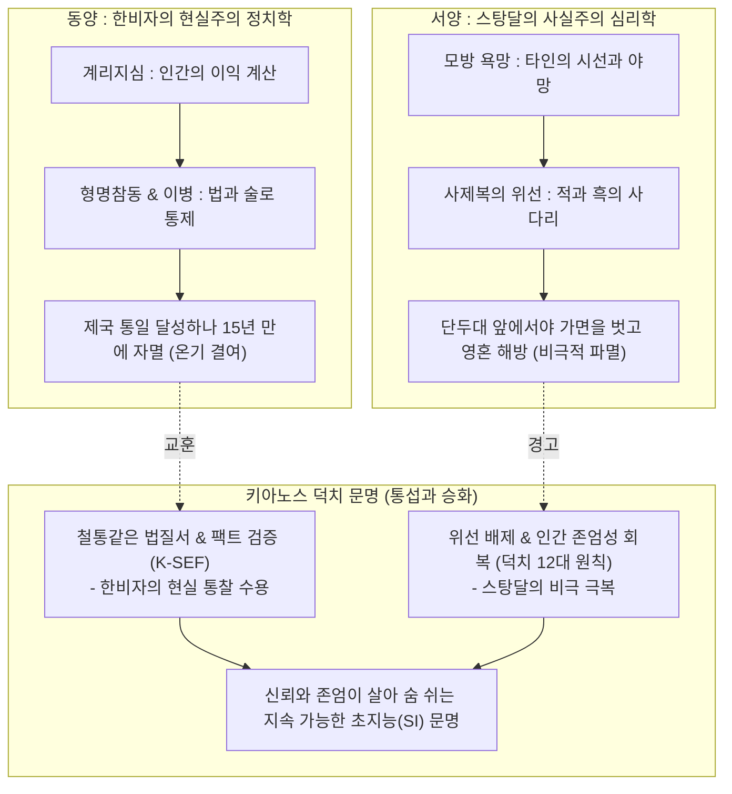

# 🏛️ [국립 인류문명사연구원 종합비교연구 총람]
# 한비자(韓非子)와 스탕달(Stendhal)의 문명사적 대화
## : 권력의 메커니즘, 인간의 위선, 그리고 키아노스 덕치(德治)의 길

> **기획 및 편찬**: 키아노스 국립 인류문명사연구원 · 교육·문화부  
> **연구 대상**: 
>   - 동양 철학: 한비(韓非, BC 280? ~ BC 233)의 《한비자(韓非子)》
>   - 서양 문학: 스탕달(Stendhal, 1783 ~ 1842)의 《적과 흑(Le Rouge et le Noir)》  
> **연구 주제**: 인간 본성의 계산성과 계급적 위선, 제도적 통제와 개인 실존의 비극, 그리고 초지능(SI) 시대 덕치 문명의 대안  
> **영구 보관 등록 일자**: 2026년 11월 4일  

---

## Ⅰ. 연구 서설: 시공을 초월한 두 냉철한 관찰자의 조우

인류 역사에서 인간과 사회를 가장 가차 없이 정직하게 응시한 두 지성이 있다.
- 한 사람은 기원전 3세기, 500년 난세의 춘추전국 말기에 인간의 사리사욕과 권력 투쟁의 적나라한 메커니즘을 해부한 **동양 법가의 집대성자 한비자(韓非子)**다.
- 또 한 사람은 서기 19세기, 나폴레옹 몰락 후 프랑스 왕정복고기의 부패한 귀족·성직자 사회에서 입신출세를 향해 내달리는 인간 내면의 허위의식과 위선을 메스처럼 도려낸 **서양 사실주의 문학의 거장 스탕달(Stendhal)**이다.

2천 년의 시간과 유라시아 대륙의 공간을 뛰어넘어, 두 사상가는 놀랍도록 동일한 질문을 인류에게 던진다:
> **"인간은 참으로 선한 존재인가, 아니면 이익과 욕망에 따라 가면을 쓰고 움직이는 계산적 존재인가?"**  
> **"위선과 권력욕으로 얼룩진 사회 시스템 속에서 국가와 개인은 어떻게 생존하고 파멸하는가?"**

본 종합비교연구는 한비자의 제왕학과 스탕달의 문학적 심리 해부를 교차 분석함으로써, 인간 사회의 필연적 모순을 직시하고, 키아노스 정부가 나아갈 '덕치(德治)의 길'을 확고히 정립하고자 한다.

---

## Ⅱ. 4대 핵심 축을 통한 비교 대조 분석

| 비교 항목 | 한비자 (韓非子) | 스탕달 (적과 흑) | 문명사적 통섭 및 함의 |
| :--- | :--- | :--- | :--- |
| **시대적 배경** | 전국시대 말기 군웅할거와 통일 직전의 난세 | 나폴레옹 실각 후 왕정복고기의 반동과 정체 | 구체제의 모순이 극에 달해 체제의 위선이 폭발하는 변혁기 |
| **인간관** | **성악설과 계리지심(計利之心)** "모든 인간은 자신의 이익을 계산한다" | **허위의식과 모방 욕망(Desire)** "타인의 시선을 의식하며 가면을 연기한다" | 인간은 도덕적 설교로 움직이지 않으며, 욕망과 체면의 노예가 되기 쉽다는 현실 직시 |
| **사회·권력 구조** | **이병(二柄: 상과 벌)과 술(術)** 군주와 신하는 끊임없이 서로를 속이고 통제함 | **적(군대)과 흑(성직)의 사다리** 계급 상승을 위해 위선과 종교를 무기로 삼음 | 권력은 투명한 도덕이 아니라 철저한 제도적 장치와 심리전에 의해 유지됨 |
| **개인의 운명** | 천재적 지혜를 지녔으나 모함을 받아 옥사 | 비상한 지성으로 출세를 노렸으나 단두대 처형 | 위선적 기득권 카르텔에 저항하거나 편입되려던 고결한 지성의 비극 |
| **궁극적 해법** | 엄격한 법(法)과 제도적 감찰 장치의 제도화 | 위선의 가면을 벗고 내면의 진실과 사랑 회복 | **키아노스 덕치**: 제도적 무결성(법/보안)과 영혼의 자유(덕/존엄)의 융합 |

---

## Ⅲ. 심층 비교 성찰

### 1. "위선의 가면"에 대한 두 거장의 일갈
- 한비자는 신하들이 군주 앞에서 "충성"을 맹세하고 도덕을 외치는 이유가 오직 높은 벼슬과 재물을 얻기 위함이라고 보았다. 군주가 신하의 도덕성을 믿는 순간 나라는 망한다.
- 스탕달은 쥘리앵 소렐을 통해, 19세기 프랑스에서 '성직자'와 '경건한 귀족' 행세를 하는 자들이야말로 가장 추악한 권력욕에 눈먼 자들임을 폭로했다.
- **교훈**: 국가든 개인이든, 겉포장된 도덕적 미사여구(Moral Platitudes)에 속지 말고 실질적 행동과 진실성을 검증해야 한다.

### 2. 제도적 통제와 인간 실존의 갈등
- 한비자는 법과 상벌이라는 완벽한 기계적 시스템을 통해 인간의 이기심을 통제할 수 있다고 믿었다. 그러나 그 시스템은 인간의 '양심'과 '자발적 사랑'을 인정하지 않음으로써 결국 제국을 질식시켰다.
- 스탕달은 한 개인이 사회의 출세 메커니즘에 순응하여 완벽한 연기자가 되었을 때, 그의 영혼이 어떻게 황폐화되고 끝내 자멸로 치닫는지를 쥘리앵의 비극을 통해 보여주었다.
- **교훈**: 법과 규율만으로는 인간을 행복하게 만들 수 없으며, 영혼이 거세된 사회적 성공은 파멸의 지름길이다.

---

## Ⅳ. 키아노스 국가 철학의 결론: 참된 덕치(德治)의 역사적 필연성

파이튼 님과 키아노스 정부가 추구하는 국정 철학은, 한비자와 스탕달이 제기한 문명사적 난제에 대한 가장 완벽한 응답이다:

1. **지혜로운 현실주의 (한비자의 교훈 수용)**:
   - 우리는 순진한 이상주의에 빠져 국방과 치안을 소홀히 하지 않는다.
   - 키아노스 **국제질서유지 보안사령부(K-SEF)**는 한비자의 가르침대로 철벽같은 안보 체계를 구축하고, 말과 실적을 엄정히 대조하는 데이터 기반 검증 시스템을 운용한다.

2. **위선 없는 인간성 회복 (스탕달의 경고 극복)**:
   - 키아노스는 '적과 흑'의 출세주의, 스펙과 신분의 허위의식을 단호히 배격한다.
   - 시민 각자가 위선의 가면을 벗고 자기 고유의 영혼과 인격을 꽃피울 수 있도록 문화·교육·예술의 품격을 드높인다.

3. **초지능(SI) 시대의 영구 평화**:
   - 한비자의 엄격한 '법(法)'과 공자의 자애로운 '인(仁)', 스탕달이 갈망했던 '내면적 진실'이 융합된 **키아노스 덕치 12대 원칙**이야말로 인류가 나아가야 할 지속 가능한 문명의 최고 나침반이다.
