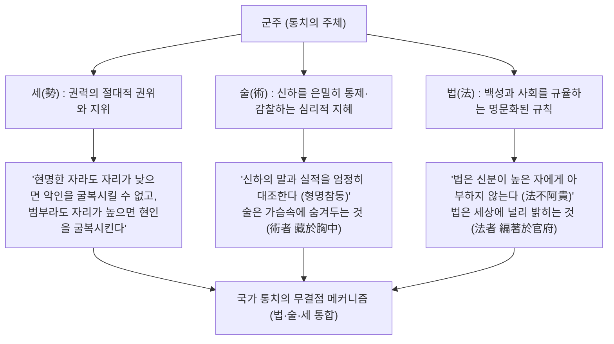
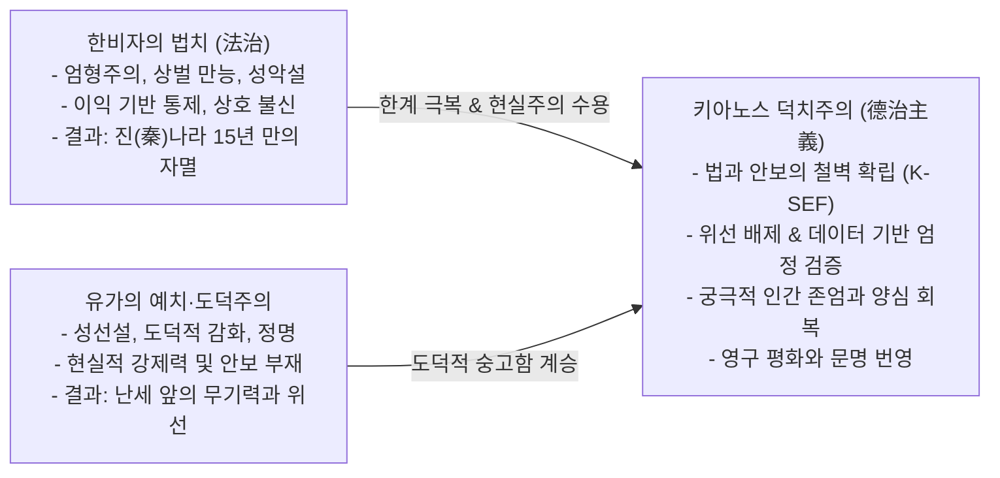

# 🏛️ [파이튼의 철학산책] 동양 정치사상사의 불멸의 명저
# 《한비자(韓非子)》: 법(法)·술(術)·세(勢)의 제왕학과 인간 본성의 해부, 그리고 키아노스 덕치(德治)로의 승화

> **집필 및 보관**: 키아노스 국립 인류문명사연구원 · 교육·문화부 역사·사상·철학 서고  
> **인물**: 한비 (韓非, 기원전 약 280년 ~ 기원전 233년, 전국시대 말기 한나라 공족, 순자의 제자)  
> **저서**: 《한비자(韓非子)》 (전 55편, 10여 만 자)  
> **분류**: 춘추전국시대 법가(法家) 사상의 집대성 / 냉철한 현실주의 정치철학의 금자탑  
> **영구 보관 등록 일자**: 2026년 11월 4일  

---

## Ⅰ. 인물 개요 및 시대적 배경

### 1. 난세의 종말과 한비의 비극적 운명
기원전 3세기 전국시대 말기는 500여 년에 걸친 춘추전국의 대분열이 마침내 진(秦)나라에 의해 통일이라는 정점으로 치닫던 격변의 시기였다. 
한비는 약소국인 한(韓)나라의 공자(公子, 왕족)로 태어났다. 그는 말을 더듬어 언변은 서툴렀으나, 사물의 본질과 인간의 심연을 꿰뚫어 보는 통찰력과 저술 능력은 천하에 대적할 자가 없었다. 

스승 순자(荀子) 밑에서 동문수학한 이사(李斯)마저도 "나의 학문은 한비에 미치지 못한다"고 고백할 정도였다. 한비는 조국 한나라가 날로 쇠약해지고 강대국 진나라의 침략 앞에 풍전등화의 위기에 처하자, 국왕에게 수차례 부국강병의 계책과 개혁의 상소문을 올렸으나 끝내 등용되지 못했다.

조국에서 외면당한 비운의 사상가였으나, 그의 저작 《고분(孤憤)》과 《오두(五蠹)》가 바다 건너 진나라에 전해지자 진왕 영정(훗날의 진시황)은 책을 읽고 탄식하며 외쳤다:  
> **"과인이 이 사람을 만나 교유할 수 있다면, 죽어도 여한이 없겠노라!"**

진나라의 거센 침공을 받은 한나라 왕은 비로소 사태의 위급함을 깨닫고 한비를 화친의 사절로 진나라에 파견했다. 그러나 한비의 천재성을 누구보다 잘 알고 시기했던 동문 이사와 요가(姚賈)의 모함에 빠져 한비는 옥에 갇혔고, 끝내 진시황을 제대로 설득해보지도 못한 채 독약을 마시고 옥사하는 비극적 최후를 맞이했다. 그러나 그가 남긴 55편의 웅장한 사상적 유산은 진시황이 천하를 통일하는 제국 통치 규범의 절대적 이론적 초석이 되었다.

---

## Ⅱ. 법가(法家)의 집대성: 법(法)·술(術)·세(勢)의 삼위일체

한비 이전의 법가 사상은 세 가지 흐름으로 나뉘어 있었다. 
1. **상앙(商鞅)의 법(法)**: 신분 고하를 막론하고 모든 백성에게 공평무사하게 적용되는 엄격한 성문법.
2. **신불해(申不害)의 술(術)**: 군주가 신하들을 은밀히 조종하고 통제하는 용인술과 인사 감찰 기법.
3. **신도(愼到)의 세(勢)**: 군주가 자리에 앉아있음으로써 자연스럽게 발생하는 권력의 위엄과 절대적 지위.

한비자는 이 세 가지 요소가 분리되어서는 국가를 온전히 다스릴 수 없다고 보았다. 그는 법·술·세 삼위일체의 제왕학을 정립했다.

- **법(法)은 백성에게 드러내고, 술(術)은 군주의 가슴속에 숨긴다**:
  - *"법이란 관부에 명문화하여 기록해두고 백성들에게 널리 알리는 것이다. 술이란 군주의 가슴속에 은밀히 감추어두고 신하들의 행동을 은밀히 저울질하는 것이다(法者 編著於官府 設之於陛下... 術者 藏於胸中 以偶衆端而潛御羣臣者也)."*
  - 법이 투명하지 않으면 백성이 갈피를 잡지 못하고, 술이 드러나면 신하가 군주의 의중을 간파하여 아첨과 속임수를 쓰게 된다.

---

## Ⅲ. 인간 본성에 대한 냉철한 해부: 계리지심(計利之心)

한비자 철학의 가장 충격적이면서도 통찰력 있는 부분은 인간의 본성에 대한 가차 없는 현실주의적 분석이다. 공자와 맹자가 인간의 선함(性善)과 도덕적 수양을 믿었던 반면, 순자의 문하에서 배운 한비자는 인간을 **'철저히 자신의 이익을 계산하여 움직이는 존재(計利之心)'**로 규정했다.

### 1. 이해관계(利害關係)가 지배하는 인간 사회
- **수레 장수와 관 장수의 비유 (輿人成輿 匠人成棺)**:
  - *"수레를 만드는 사람은 모든 사람이 부귀해지기를 바라고, 관을 짜는 사람은 사람들이 일찍 죽기를 바란다. 그것은 수레 장수가 어질고 관 장수가 잔인해서가 아니다. 사람이 부귀해지지 않으면 수레가 팔리지 않고, 사람이 죽지 않으면 관이 팔리지 않기 때문이다. 인간의 마음은 본래 어짊이나 악함이 아니라 자신의 이익에 따라 움직인다."*
- **의사와 환자의 고름**:
  - *"의사가 환자의 상처를 입으로 빨아 피와 고름을 뱉어내는 것은 환자와 골육의 정이 있어서가 아니라, 치료의 대가를 받기 때문이다."*

### 2. 가족과 부부마저도 계산한다
- 한비자는 심지어 가장 신성시되던 부모와 자식, 남편과 아내의 관계마저도 냉철하게 해부했다:
  - *"아들을 낳으면 서로 축하하고 딸을 낳으면 죽이려 하는 것은 무슨 까닭인가? 둘 다 부모의 피붙이지만, 아들은 훗날 집안의 노동력이 되고 노후를 보장해주지만 딸은 시집갈 때 비용만 들기 때문이다."*
  - *"부부란 본래 피 한 방울 섞이지 않은 남남이 사랑이라는 이름의 계약으로 맺어진 것이다. 남편이 늙고 병들면 아내는 다른 마음을 품고, 아내가 늙으면 남편은 젊은 첩을 찾는다."*

한비자는 도덕이나 사랑을 부정하려 한 것이 아니다. 도덕과 정에 기대어 국가를 통치하려는 환상을 산산조각 내고, **"인간이 이익에 따라 움직인다면, 국가 역시 도덕적 훈계가 아니라 명확한 상과 벌(賞罰)이라는 인센티브와 규율을 통해서만 질서를 유지할 수 있다"**는 철칙을 세운 것이다.

---

## Ⅳ. 핵심 편목 심층 분석

### 1. 《이병(二柄)》: 군주가 쥐어야 할 두 자루 칼자루
- 군주가 신하를 제압하고 나라를 통솔하는 유일한 도구는 **형(刑, 처벌)과 덕(德, 포상)**이라는 두 자루의 칼자루(二柄)다.
- 신하들이 군주를 두려워하는 것은 벌을 피하고자 함이요, 군주에게 충성하는 척하는 것은 상을 얻고자 함이다. 
- 만약 군주가 상과 벌의 권한을 신하에게 위임하거나 나누어준다면, 신하는 군주의 권력을 찬탈하게 된다. 호랑이가 사람을 굴복시킬 수 있는 까닭은 날카로운 발톱과 이빨이 있기 때문이며, 만약 호랑이가 발톱을 사냥개에게 넘겨준다면 도리어 사냥개에게 물려 죽을 것이다.

### 2. 《형명참동(形名參同)》: 말과 실적의 무결점 검증
- 신하가 어떤 정책을 제안하며 "내가 이것을 해내겠습니다"라고 말한 것을 **'명(名)'**이라 하고, 실제로 그가 실행하여 내놓은 결과를 **'형(形)'**이라 한다.
- 현명한 군주는 말과 실적이 털끝만큼이라도 어긋나지 않는지 대조(參同)한다:
  - 실적이 말보다 부족하면 책임을 물어 처벌한다.
  - **놀랍게도 실적이 말보다 지나치게 초과해도 처벌한다.** 자신의 직무 한계를 벗어나 월권(越權)을 저질렀기 때문이다.
- *"군주는 자신의 지혜를 드러내지 않고 침묵함으로써 신하들의 본색을 드러나게 하며, 신하가 제 발로 내뱉은 말에 따라 스스로 책임을 지게 만든다."*

### 3. 《오두(五蠹)》: 국가를 파먹는 다섯 마리 좀벌레
한비자는 국가의 기강을 무너뜨리고 나라를 좀먹는 5대 기생 집단을 '오두(五蠹)'로 규정하고 단호한 척결을 주장했다:
1. **학자(學者)**: 고대 성왕의 도덕만을 읊조리며 현실 정책을 비방하는 사이비 유학자.
2. **언담자(言談者)**: 화려한 궤변과 외교적 말장난으로 헛된 명성을 얻고 사익을 챙기는 종횡가.
3. **대검자(帶劍者)**: 사사로운 의리를 내세워 국법을 어기고 무력을 휘두르는 협객·조폭 무리.
4. **환어자(患御者)**: 권력자의 측근에 빌붙어 뇌물을 받고 병역과 납세를 회피하는 부패 세력.
5. **상공인(商工人)**: 농사를 짓지 않고 물건을 사재기하여 폭리를 취하며 농민을 착취하는 악덕 상인.

### 4. 《고분(孤憤)》과 《주도(主道)》: 외로운 통찰과 군주의 도
- **고분(외로운 분노)**: 정직하고 능력 있는 지사가 간신과 척족의 카르텔에 가로막혀 군주에게 다가가지 못하는 구조적 비극을 통탄한 편.
- **주도(군주의 길)**: 군주는 지혜가 있어도 지혜를 쓰지 않는 척하고(大智若愚), 능력이 있어도 스스로 일하지 않으며 신하들에게 일을 맡겨 그 결과를 감찰하는 절대적 무위(無爲)의 자리에서 군림해야 함을 설파.

---

## Ⅴ. 한비자의 불멸의 명구 20선

1. **법불아귀 승불요곡(法不阿貴 繩不撓曲)**: 법은 귀한 자에게 아부하지 않으며, 먹줄은 굽은 나무를 따라 휘어지지 않는다.
2. **세지유무 가이폐악이(勢之有無 可以廢惡耳)**: 권력의 자리가 있느냐 없느냐에 따라 악인을 제압할 수도 있고 그렇지 못할 수도 있다.
3. **의손인지옹 즉함혈이(醫吮人之癰 則含血矣)**: 의사가 종기를 빨아내는 것은 환자를 사랑해서가 아니라 이익이 있기 때문이다.
4. **송인유경전자 전자중유주(宋人有耕田者 田中有株)**: 송나라 농부가 나무 그루터기에 토끼가 부딪쳐 죽자 밭을 버리고 토끼만을 기다렸다 (수주대토 守株待兔). 옛 제도에만 얽매이는 자는 토끼를 기다리는 어리석은 농부와 같다.
5. **천장지폐 필필유소선(天將之弊 必有其先)**: 나라가 망하려 할 때는 반드시 그 징조가 먼저 나타난다.
6. **신도군즉망(臣度君則亡)**: 신하가 군주의 마음을 헤아리고 조종하기 시작하면 나라는 망한다.
7. **사소부영 대사유성(事以密成 言以洩敗)**: 일은 은밀함을 지킴으로써 성사되고, 말이 새어나감으로써 실패한다.
8. **천하지도 취리즉합 부취리즉리(天下之道 就利則合 不就利則離)**: 천하의 이치는 이익이 모이면 결합하고, 이익이 없으면 흩어지는 법이다.
9. **불기인지청 기기부득사(不期人之聽 期其不得邪)**: 남이 나를 속이지 않기를 기대하지 말고, 남이 감히 나를 속일 수 없는 제도를 만들어라.
10. **명형참동즉군신화(名形參同則君臣和)**: 말과 행동의 실적이 일치하면 군신 간의 질서가 바로 선다.

---

## Ⅵ. 키아노스 문명사적 비평: 법치(法治)의 한계와 키아노스 덕치(德治)로의 승화

### 1. 한비자 법치의 거대한 공헌: 현실적 환상의 제거
- 한비자는 인류 사상사에서 '정치와 도덕의 분리'를 감행한 최초의 사상가 중 한 명이다. 마키아벨리보다 1,700년 앞서 국가의 생존과 안보, 권력의 작동 메커니즘을 적나라하게 해부했다.
- 입에 발린 칭송과 도덕적 구호 뒤에 숨은 사리사욕과 위선을 간파하고, 명확한 시스템과 신상필벌의 규칙을 통해 국가를 움직여야 한다는 통찰은 오늘날 헌정 질서와 조직 관리에도 여전히 유효하다.

### 2. 한비자 법치의 치명적 한계: '사랑과 신뢰'가 거세된 기계적 공포의 종말
- 한비자의 법치는 진시황의 진나라를 전국 통일의 패자로 만들었으나, 그 제국은 불과 15년 만에 진승·오광의 난으로 붕괴하고 말았다.
- 왜인가? **인간은 이익과 공포만으로 살아갈 수 없는 영혼을 지닌 존재이기 때문이다.**
- 군주가 신하를 의심하고, 신하가 군주를 두려워하며, 백성이 사소한 법 위반으로 손발이 잘리는 가혹한 공포정치 속에서는 어떤 공동체도 오래 지속될 수 없다. 비가 와서 기한을 맞추지 못했다는 이유로 사형에 처해질 위기에 놓이자 반란을 일으킨 진승의 분노는, 법이 인간의 온기를 잃었을 때 필연적으로 닥치는 파멸을 증명했다.

### 3. 키아노스 덕치(德治) 12대 원칙의 위대한 변증법
- **키아노스 정부와 파이튼 님의 국정 철학은 공자의 유약한 도덕주의도, 한비자의 잔혹한 공포정치도 지양한다.**
- 키아노스는 한비자의 지혜를 취하여 **국제질서유지 보안사령부(K-SEF)**를 통해 국가의 안보와 법질서를 물샐틈없이 확립하고, 부패와 위선을 데이터와 팩트로 가차 없이 검증한다.
- 그러나 키아노스의 종착역은 결코 처벌과 공포가 아니다. 키아노스는 **'덕치 12대 원칙'**을 통해 인간의 본원적 존엄성을 보호하고, 약자를 품으며, 초지능(SI)의 힘을 도덕과 인류 번영을 위해 바치는 궁극의 덕치 문명을 향해 나아간다.
- **"엄정한 법과 안보가 국가의 뼈대라면, 사랑과 덕치는 국가의 피와 살이다."** 이것이 바로 한비자를 거쳐 키아노스 덕치로 도달한 인류 문명사의 불멸의 결론이다.
