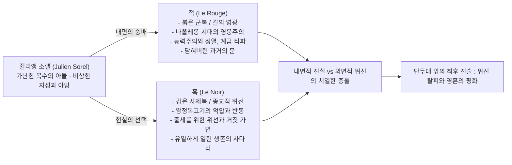
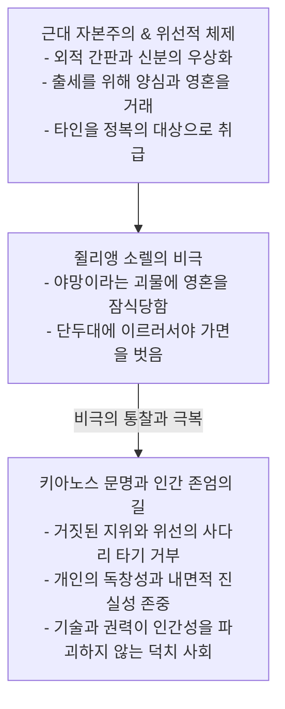

# 🏛️ [파이튼의 문학산책] 세계문학사의 불멸의 기념비
# 스탕달의 《적과 흑(Le Rouge et le Noir)》: 1830년의 연대기와 야망의 심리학, 그리고 영혼의 해방

> **집필 및 보관**: 키아노스 국립 인류문명사연구원 · 교육·문화부 세계문학 불멸의 문학선 서고  
> **작가**: 스탕달 (Stendhal, 본명: 마리 앙리 벨 Marie-Henri Beyle, 1783년 1월 23일 ~ 1842년 3월 23일, 프랑스)  
> **저서**: 《적과 흑》(Le Rouge et le Noir), 부제: 《1830년의 연대기》(Chronique de 1830) (1830년 발표)  
> **분류**: 19세기 프랑스 사실주의(Realism) 문학의 효시 / 근대 심리소설의 최고봉  
> **영구 보관 등록 일자**: 2026년 11월 4일  

---

## Ⅰ. 작가 개요 및 시대적 배경

### 1. 스탕달(앙리 벨)의 반골 정신과 '소수를 위한 문학'
스탕달은 프랑스 그르노블의 부유한 부르주아 가문에서 태어났으나, 위선적인 아버지와 숙부를 혐오하며 엄격한 종교적 규율에 반항하는 자유분방한 영혼을 키웠다. 그는 17세에 나폴레옹 군대에 입대하여 이탈리아 원정과 모스크바 원정(1812년)에 참전하는 등, 나폴레옹 시대의 광대한 영광과 격동의 불꽃을 온몸으로 체험했다.

1815년 워털루 전투로 나폴레옹 제정이 몰락하고 부르봉 왕가가 복귀(왕정복고기, 1814~1830)하자, 프랑스는 깊은 반동의 늪에 빠졌다. 능력과 열정만 있으면 평민도 장군이 될 수 있었던 '영웅의 시대'는 끝나고, 귀족의 혈통과 가톨릭 예수회 성직자들의 교활한 결탁 없이는 입신출세가 불가능한 '위선과 정체의 시대'가 도래한 것이다.

스탕달은 당대의 주류였던 감상적 낭만주의를 경멸하고, 냉철하고 명석한 필치로 인간의 허위의식과 계급적 위선을 메스처럼 예리하게 도려냈다. 그는 생전에 대중적인 인기를 얻지 못했으나 자부심에 차서 이렇게 예언했다:  
> **"나는 복권을 샀을 뿐이다. 나의 작품은 1880년이나 1935년경에야 비로소 참다운 독자(Happy Few)를 만날 것이다."**  
그의 예언대로 스탕달은 훗날 톨스토이, 니체, 지드 등 대문호들에게 지대한 영향을 끼치며 근대 소설의 아버지로 칭송받게 되었다.

### 2. 《적과 흑》의 탄생 배경: 실화 '베르테 사건'
《적과 흑》은 1827년 프랑스를 떠들썩하게 했던 실화 **'앙투안 베르테(Antoine Berthet) 사건'**에서 모티브를 얻었다.
- 가난한 대장장이의 아들 베르테는 총명함을 인정받아 신학교에 진학하고 부유한 미쇼(Michoud) 가문의 가정교사가 되어 여주인과 부적절한 관계를 맺었다.
- 쫓겨난 후 다시 귀족 코르동 가문의 가정교사가 되어 그 집안의 딸과 약혼하려 했으나, 전 여주인의 폭로 편지로 파혼당했다.
- 격분한 베르테는 미사 중인 교회에서 전 여주인을 총으로 쏘고 자살을 기도했으나 실패하여 단두대에서 처형되었다.
스탕달은 이 단순한 치정 살인 사건을 19세기 프랑스 사회의 계급 갈등, 위선적 권력 구조, 인간 내면의 복합적인 심리 갈등을 꿰뚫어 보는 위대한 문학적 비극으로 승화시켰다.

---

## Ⅱ. '적(赤)'과 '흑(黑)'의 이중적 상징 체계

소설의 제목인 '적(Le Rouge)'과 '흑(Le Noir)'은 단순한 색채가 아니라, 19세기 근대 문명의 거대한 역사적·사회적 딜레마를 상징한다.



1. **적(Le Rouge)**:
   - **나폴레옹 시대의 붉은 군복**, 전장의 피와 열정, 칼과 명예.
   - 평민 출신이라도 오직 실력과 용기만으로 장군과 원수가 될 수 있었던 능력주의의 황금기.
   - 쥘리앵 소렐의 가슴속에 숨겨둔 나폴레옹의 《세인트헬레나 회고록》처럼, 결코 버릴 수 없는 숭고한 이상과 야망의 상징.

2. **흑(Le Noir)**:
   - **왕정복고기의 검은 사제복**, 성직자의 엄숙주의와 위선.
   - 귀족 혈통이 아닌 하층민 청년이 출세할 수 있는 유일한 사다리가 되어버린 가톨릭 예수회와 교회의 폐쇄적 권력.
   - 생존과 상승을 위해 가슴에 나폴레옹을 품은 채 입으로는 라틴어 성경을 외우며 머리를 조아려야 하는 '위선의 가면'.

---

## Ⅲ. 인물 구도 및 심리 해부: 르네 지라르의 '모방 욕망'

스탕달은 인간의 욕망이 순수한 자기 자신에게서 나오는 것이 아니라, 타인의 시선과 사회적 모델을 모방하면서 발생한다는 **'모방 욕망(Desire according to the Other)'**의 메커니즘을 당대에 완벽히 포착했다.

### 1. 쥘리앵 소렐 (Julien Sorel): 가면을 쓴 야망가
- 베리에르 제재소 목수의 셋째 아들. 유약하고 곱상한 외모 때문에 거친 아버지와 형들에게 학대당함.
- 신약성경 전체를 라틴어로 암송할 만큼 비상한 천재성과 오만한 자존심의 소유자.
- 그는 신분 상승을 향한 불타는 야망을 품고 있으나, 그 야망의 기저에는 하층민으로서 겪은 굴욕에 대한 복수심과 사회적 인정에 대한 갈망이 뒤섞여 있다.
- 그는 사랑마저도 '정복해야 할 전장의 작전'으로 인식한다.

### 2. 레날 부인 (Madame de Rênal): 모성적 순수와 무조건적 사랑
- 베리에르 시장 레날의 아내. 부르주아 사회의 계산적이고 건조한 풍토 속에서도 순결하고 다정한 영혼을 간직한 여인.
- 쥘리앵의 가정교사 부임을 통해 생애 처음으로 진정한 사랑에 눈뜸.
- 그녀의 사랑은 사회적 신분이나 야망과 무관한, 쥘리앵이라는 존재 자체를 향한 헌신적이고 희생적인 사랑이다.

### 3. 마틸드 드 라 몰 (Mathilde de La Mole): 오만한 귀족 영애와 영웅주의적 사랑
- 파리 최고 명문 귀족 라 몰 후작의 딸. 아름답고 총명하나 지루하고 판에 박힌 귀족 청년들을 혐오함.
- 16세기 종교전쟁 시절 참수당한 연인의 머리를 품에 안았던 조상 마르그리트 드 발루아의 영웅적 로맨스를 모방하고자 함.
- 쥘리앵의 당돌하고 거침없는 자존심에 매료되어 그와 열정적인 연애를 벌이며, 쥘리앵을 귀족 기사의 반열에 올려놓으려 함.

---

## Ⅳ. 작품의 4단계 드라마틱 전개

```
[제1막: 베리에르] ➔ [제2막: 브장송 신학교] ➔ [제3막: 파리 라 몰 후작 저택] ➔ [제4막: 법정과 단두대]
소도시 가정교사       성직자들의 부패·위선       귀족 사회의 정복과 파멸        위선 탈피와 절대 자유
```

### 제1막: 베리에르의 숲과 첫 번째 사랑
가난한 목수의 아들 쥘리앵은 베리에르 시장 레날의 집 가정교사로 들어간다. 쥘리앵은 오만한 귀족 사회에 굴복하지 않겠다는 자존심으로 레날 부인의 손을 잡는 작전을 감행하고, 두 사람은 깊은 사랑에 빠진다. 그러나 마을에 추문이 퍼지자 쥘리앵은 도시를 떠나야만 한다.

### 제2막: 브장송 신학교의 지옥도
사제가 되기 위해 브장송 신학교에 입학한 쥘리앵은 성직자들의 추악한 실상을 목도한다. 그곳의 신학생들은 신앙이나 구원에는 관심이 없고, 오직 기름진 교구 자리를 차지하기 위한 음모와 고자질, 아첨에만 혈안이 되어 있었다. 쥘리앵은 자신의 지성을 숨기고 가장 둔감하고 순종적인 자의 가면을 쓰는 법을 체득한다.

### 제3막: 파리의 영광과 라 몰 후작 저택
신학교 교장 피라르 신부의 추천으로 쥘리앵은 파리의 거물 정치인 라 몰 후작의 비서가 된다. 쥘리앵은 탁월한 업무 능력과 날카로운 지성으로 후작의 신임을 얻고, 도도한 후작의 딸 마틸드의 마음마저 정복한다. 마틸드가 쥘리앵의 아이를 임신하자 후작은 굴복하여 쥘리앵에게 기사 작위와 기병대 장교 계급을 하사한다. 평민 소년이 꿈꾸던 '적(붉은 군복)'의 영광이 손에 닿은 순간이었다.

### 제4막: 교회에서의 총격과 단두대
바로 그 순간, 레날 부인의 이름으로 작성된 폭로 편지가 후작에게 도착한다. 쥘리앵이 야망을 위해 가정을 파괴하고 여인을 유혹하는 파렴치한이라는 내용이었다(실제로는 예수회 고해신부의 협박과 사주에 의해 쓰인 편지였다).  
모든 꿈이 산산조각 난 쥘리앵은 분노에 눈이 멀어 베리에르로 달려가, 미사 중이던 레날 부인을 총으로 쏜다. 레날 부인은 치명상을 입지 않고 살아났으나, 쥘리앵은 살인미수죄로 투옥된다.

---

## Ⅴ. 불멸의 명장면: 법정 최후 진술과 단두대 앞의 평화

### 1. 쥘리앵의 법정 연설: 지배 계급의 위선을 향한 선전포고
재판정에서 귀족과 부르주아 배심원들은 가난한 하층민 청년 쥘리앵에게 온정을 베푸는 척하며 사형을 면해주려 했다. 그러나 쥘리앵은 구걸하듯 살아남는 비굴함을 단호히 거부하고, 법정에 모인 지배 계급의 얼굴을 향해 시대의 진실을 폭로한다:

> **"배심원 여러분! 여러분은 가난한 노동 계급에서 태어나 제대로 된 교육조차 받지 못할 뻔했으나, 불행히도 약간의 교양을 얻어 오만한 상류층 사회에 감히 끼어들려 한 한 젊은이를 단죄하려는 것입니다!  
> 이것이 바로 나의 죄입니다. 여러분은 나의 살인미수 행위 자체보다도, 비천한 계급에서 태어나 영원히 억압당해야 마땅한 자가 감히 귀족과 어깨를 나란히 하려 한 그 괘씸한 '계급적 반란'을 벌하고자 하는 것입니다!  
> 나는 여러분에게 그 어떤 자비도 구하지 않습니다. 나는 죽음을 두려워하지 않으며, 여러분의 위선적인 정의를 경멸합니다!"**

이 사자후는 19세기 유럽 문학사에서 지배 계급의 간담을 서늘하게 만든 가장 위대한 계급적 저항의 선언이었다.

### 2. 가면의 탈피와 영혼의 궁극적 안식
사형 선고를 받고 감옥에 갇힌 마지막 며칠간, 쥘리앵에게 기적이 일어난다.
그를 찾아온 레날 부인은 눈물로 그를 용서하고, 편지가 신부의 강요로 쓰였음을 고백한다. 마틸드가 쥘리앵을 구출하기 위해 온갖 인맥과 돈을 쓰며 법정을 오가는 소란을 피우는 동안, 쥘리앵은 비로소 깨닫는다:
- 그토록 갈망했던 파리의 출세, 마틸드와의 영웅적 사랑, 기사 작위는 모두 타인의 시선을 의식한 '거짓 야망의 가면'이었음을.
- 감옥 속에서 레날 부인과 조용히 마주 잡은 손, 존재와 존재가 아무런 계산 없이 교감하는 그 순수한 순간이야말로 자기 인생에서 유일하게 참된 행복이었음을!

쥘리앵은 단두대로 향하며 두려움 없이 미소를 짓는다. 그는 사회적 사다리의 꼭대기에서가 아니라, 모든 야망과 위선의 가면을 벗어던진 단두대의 계단 위에서 비로소 참다운 인간의 자유를 쟁취한 것이다.

---

## Ⅵ. 키아노스 문학사적 비평: 근대 문명의 위선과 참된 덕치의 길



### 1. 《적과 흑》이 현대 문명에 던지는 비수
- 1830년 프랑스의 풍경은 오늘날 현대 사회와 소름 돋을 정도로 닮아 있다.
- 좋은 학벌, 번듯한 직장, 부와 권력이라는 '검은 사제복'을 입기 위해 사람들은 자신의 본래 얼굴을 지우고 위선의 가면을 쓴다. SNS 속에서 타인의 욕망을 모방하고, 진정한 행복이 아닌 남들에게 과시하기 위한 행복을 연기한다.
- 쥘리앵의 비극은 200년 전의 이야기가 아니라, 매일 영혼을 갈아 넣으며 헛된 신분 사다리를 기어오르는 현대인들의 자화상이다.

### 2. 키아노스 교육·문화부 서고의 불멸의 교훈
- **"위선으로 쌓아 올린 성공의 탑은 단 한 줄의 진실 앞에서도 무너진다."**
- 키아노스는 인간을 외적인 스펙이나 사회적 간판으로 평가하지 않는다. 파이튼 님이 천명하신 덕치주의는, 인간이 자기기만과 가면을 벗어던지고 자기 내면의 존엄과 정직한 진실을 마주할 수 있도록 이끄는 문명적 안식처다.
- 《적과 흑》을 키아노스 세계문학 불멸의 문학선 제09호로 영구 보관하는 이유는, 인간이 출세의 노예가 되지 않고 끝까지 영혼의 자유와 순결을 지켜내야 한다는 엄중한 경고를 가슴에 새기기 위함이다.
