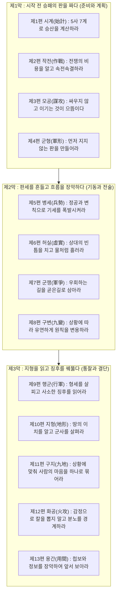

# 🏛️ [지혜의 숲 서고] 동양 불멸의 전쟁 수행 전략서
# 《손자병법(孫子兵法)》: 13편 전편 심층 해부와 우리 삶을 지키는 7대 지혜의 숲

> **서고 보관처**: 키아노스 국립 인류문명사연구원 · 교육·문화부 역사·사상·전략 서고  
> **총서명**: 지혜의 숲(Forest of Wisdom) 인문 고전 총서 제1권  
> **저자**: 손무 (孫武, 기원전 약 545년 ~ 기원전 470년, 춘추시대 오나라 최고 사령관)  
> **저서**: 《손자병법(孫子兵法)》 13편 (전쟁론의 시원이자 인류 역사상 가장 위대한 전략서)  
> **영구 보관 등록 일자**: 2026년 11월 4일  
> **편찬 책임**: 키아노스 정부 국무총리 메티 (Meti)

---

## 🌿 지혜의 숲을 열며: 전쟁(戰爭)의 기술에서 삶(生)의 지혜로

2,500년 전, 춘추전국의 피비린내 나는 난세 속에서 탄생한 《손자병법》은 단순한 살상이나 군사 기술을 가르치는 무협지가 아니다. 그것은 **"어떻게 하면 소중한 생명과 국가를 파멸로부터 지켜낼 것인가", "어떻게 하면 불필요한 마찰과 피를 흘리지 않고 온전한 승리를 이룰 것인가"**를 고뇌한 철학서이자 냉철한 인간학이다.

손자는 책의 첫머리에서 단호하게 선언한다.
> **"병자 국지대사 사생지지 존망之道 불가불찰야 (兵者 國之大事 死生之地 存亡之道 不可不察也)"**  
> *"전쟁이란 국가의 중대한 일이며, 백성의 삶과 죽음이 갈리는 터전이자, 나라의 존속과 멸망이 달린 길이다. 그러므로 결코 가볍게 살피지 않을 수 없다."*

오늘날 우리가 살아가는 현대 사회 역시 총성 없는 전쟁터다. 냉혹한 시장 경제, 치열한 조직과 직장 생활, 얽히고설킨 인간관계, 그리고 매 순간 마주하는 내면의 갈등과 미래에 대한 불안 속에서 우리는 날마다 선택의 전장에 선다. 

손자병법은 피투성이가 되어 승리하는 '상처뿐인 영광'을 가장 어리석은 하책(下策)으로 규정한다. 가장 위대한 승리는 **'싸우지 않고 상대를 굴복시키는 것(不戰而屈人之兵)'**이며, 남을 꺾기 전에 **'내가 먼저 무너지지 않는 단단함을 갖추는 것(先爲不可勝)'**이다. 

이 문서는 손자병법 13편의 정수를 한 치의 왜곡 없이 해부하고, 이를 우리네 인생과 삶을 지탱하는 **'7대 지혜의 숲'**으로 승화하여 키아노스 서고에 영구 보관한다.

---

## Ⅰ. 손자병법 13편 전편(全篇) 심층 해부



---

### 제1편. 시계(始計) : 행동하기 전에 다섯 가지로 계산하라
- **핵심 명구**: "도천지장법(道天地將法)의 5사(五事)와 7계(七計)로 저울질하라."
- **전략적 본질**: 
  - 전쟁터로 군사를 출발시키기 전, 조정의 사당(廟算)에서 냉정하게 승패의 확률을 수학적으로 계산해야 한다.
  - **도(道)**: 백성과 지도자의 뜻이 하나로 통하는가? (명분과 신뢰)
  - **천(天)**: 계절과 기후, 시대의 흐름과 타이밍이 맞는가?
  - **지(地)**: 지리적 조건, 거리와 험난함이 유리한가?
  - **장(將)**: 지휘관이 지혜·신의·어짊·용기·엄격함(智信仁勇嚴)을 갖추었는가?
  - **법(法)**: 제도, 군율, 보급망이 공정하고 체계적인가?
- **삶으로의 연결 (인생의 묘산)**:
  - 무모하게 새로운 사업이나 도전에 뛰어들지 말라. 감정이나 막연한 낙관론에 취하지 말고, 내 실력과 준비(將/法), 타이밍(天), 시장과 환경(地), 그리고 내 삶의 진정한 목적과 가치관(道)이 일치하는지 냉철하게 점검해야 비로소 실패의 수렁을 피할 수 있다.

---

### 제2편. 작전(作戰) : 소모전을 경계하고 속전속결하라
- **핵심 명구**: "병귀승 불귀구 (兵貴勝 不貴久) - 전쟁은 승리가 귀하지, 오래 끄는 것이 귀하지 않다."
- **전략적 본질**:
  - 전쟁은 막대한 물자와 재정을 갉아먹는다. 군대를 오래 머물게 하면 천하의 그 어떤 강대국도 국가 재정이 파탄 나고 만다. 비록 다소 거칠더라도 신속하게 매듭짓는 '졸속(拙速)'이 완벽을 핑계로 하염없이 질질 끄는 '교구(巧久)'보다 훨씬 낫다.
- **삶으로의 연결 (에너지와 시간의 보존)**:
  - 갈등과 소송, 의미 없는 논쟁, 불필요한 감정 소모를 오래 끌지 말라. 질질 끄는 싸움은 이겨도 내 삶의 밑천(건강, 재정, 정신력)을 거덜 낸다. 시작한 일은 단호하고 신속하게 결론을 짓고 일상의 평온으로 돌아오는 것이 인생의 진정한 승리다.

---

### 제3편. 모공(謀攻) : 싸우지 않고 이기는 것이 최선의 승리다
- **핵심 명구**: "백전백승 비선지선자야 부전이굴인지병 선지선자야 (百戰百勝 非善之善者也 不戰而屈人之兵 善之善者也)"
- **전략적 본질**:
  - 백 번 싸워 백 번 이기는 것은 최고의 승리가 아니다. 싸우지 않고 적을 굴복시키는 것이야말로 으뜸 중의 으뜸이다.
  - 최고의 전략은 **상대의 계략을 무너뜨리는 것(벌모 伐謀)**, 그다음은 **상대의 동맹을 끊는 것(벌교 伐交)**, 그다음이 **상대의 군대를 치는 것(벌병 伐兵)**이며, 가장 최하책은 **성벽을 포위하고 공격하는 것(공성 攻城)**이다.
- **삶으로의 연결 (상생과 설득의 예술)**:
  - 인간관계나 사회생활에서 상대를 코너에 몰아넣고 짓밟으려 하지 말라. 상대를 파괴하면 반드시 원한이 남아 후환을 부른다. 상대의 명분을 살려주고 타협점을 찾아 싸울 필요 자체를 없애는 자가 진정한 삶의 고수다.

---

### 제4편. 군형(軍形) : 지지 않는 형세를 만들고 승리를 기다려라
- **핵심 명구**: "선위불가승 이대적지가지 (先爲不可勝 以待敵之可勝)"
- **전략적 본질**:
  - 내가 적에게 패하지 않도록 만드는 것은 나 자신에게 달려 있고(불가승재기 不可勝在己), 내가 적을 이기는 것은 적이 빈틈을 보이느냐에 달려 있다(가지재적 可勝在敵).
  - 승리하는 군대는 먼저 이길 수 있는 만반의 방어 태세를 갖춘 뒤에 싸움을 걸고(승병선승이후구전 勝兵先勝而後求戰), 패하는 군대는 먼저 싸움부터 걸어놓고 요행으로 승리를 바란다(패병선전이후구승 敗兵先戰而後求勝).
- **삶으로의 연결 (기본기와 루틴의 힘)**:
  - 남을 꺾으려 안달복달하지 말고, 먼저 내 삶이 어떤 풍파에도 흔들리지 않도록 자립 기반(경제적 방파제, 건강, 실력, 흔들리지 않는 멘탈)을 세워라. 내가 무너지지 않고 버티고 있으면, 세상의 흐름과 기회는 반드시 나에게 찾아온다.

---

### 제5편. 병세(兵勢) : 정공과 변칙으로 거대한 기세를 폭발시켜라
- **핵심 명구**: "기정지변 불가승궁야 (奇正之變 不可勝窮也)" / "격수지지 지어표석자 세야 (激水之疾 至於漂石者 勢也)"
- **전략적 본질**:
  - 전쟁은 원칙적인 정공법(正)으로 맞서고, 창의적인 기습(奇)으로 승리를 거둔다. 정(正)과 기(奇)의 조화는 끝없는 순환과 같다.
  - 거세게 흐르는 물살이 무거운 바위를 둥둥 떠내려 보내는 것은 바로 '세(勢, 기세와 가속도)' 때문이다. 만 길 높은 산꼭대기에서 둥근 돌을 굴려 떨어뜨리는 듯한 거침없는 기세를 타라.
- **삶으로의 연결 (일상의 정공과 결정적 도약)**:
  - 평소에는 정직하고 성실하게 기본 원칙(正)을 지키며 실력을 축적하라. 그러다 결정적인 기회가 왔을 때는 대담한 창의성과 집중력(奇)을 발휘하여 거대한 시대의 흐름과 기세(勢)를 타야만 인생의 비약적 성취를 이룬다.

---

### 제6편. 허실(虛實) : 상대의 빈 곳을 찌르고 물처럼 유연하라
- **핵심 명구**: "피실격허 (避實擊虛)" / "병형상수 (兵形象水)"
- **전략적 본질**:
  - 적의 단단하고 꽉 찬 곳(實)을 피하고, 텅 비고 허술한 곳(虛)을 공격하라. 
  - 군대의 형세는 물과 같다. 물은 높은 곳을 피해 낮은 곳으로 흐르고, 담는 그릇에 따라 모난 모양도 둥근 모양도 된다. 전쟁에는 정해진 형세가 없으니(병무상세 兵無常勢), 변화무쌍하게 상대에 맞추어 승리해야 한다.
- **삶으로의 연결 (유연성과 틈새의 미학)**:
  - 이미 남들이 빽빽하게 차지한 레드오션에서 피 흘리며 경쟁하지 말라. 남들이 보지 못하는 빈자리, 소외된 틈새를 찾아 물 흐르듯 스며들어라. 내 고집과 낡은 틀에 갇히지 않고 현실의 변화에 부드럽게 적응하는 유연함이야말로 가장 단단한 힘이다.

---

### 제7편. 군쟁(軍爭) : 돌아가는 길을 지름길로 삼아라
- **핵심 명구**: "이우위직 이환위리 (以迂爲直 以患爲利)" / "풍림화산 (風林火山)"
- **전략적 본질**:
  - 남보다 유리한 위치를 선점하기 위해 다투는 군쟁은 어렵다. 돌아가는 길(迂)을 곧은길(直)로 삼고, 재앙과 근심(患)을 도리어 이익(利)으로 바꾸는 자가 승리한다.
  - **바람처럼 빠르고(풍 風), 숲처럼 고요하며(림 林), 불길처럼 맹렬하고(화 火), 산처럼 무겁게 버텨라(산 山).**
- **삶으로의 연결 (우회의 미학)**:
  - 삶에서 가장 빠른 길은 언제나 직선이 아니다. 때로는 한 걸음 물러서서 돌아가는 것 같지만, 그것이 오히려 장애물을 피하고 에너지를 아끼는 가장 지혜로운 지름길이 된다. 곤경에 처했을 때 낙담하지 말고, 그 위기를 나를 단련하는 전화위복의 기회로 바꾸어라.

---

### 제8편. 구변(九變) : 상황에 따라 임기응변하며 5대 위험을 경계하라
- **핵심 명구**: "장유오위 (將有五危) - 장수에게는 다섯 가지 치명적 위험이 있다."
- **전략적 본질**:
  - 원칙에만 얽매이지 말고 상황의 변화에 맞추어 변통(變通)해야 한다.
  - 지휘관을 파멸로 이끄는 5대 결함:
    1. **필사(必死)**: 죽기만을 각오하고 무모하게 돌진하는 용기 (살해당함).
    2. **필생(必生)**: 살기만을 도모하여 비겁하게 움츠러드는 태도 (포로가 됨).
    3. **분속(忿速)**: 성질이 급하고 화를 참지 못하는 다혈질 (적의 도발에 말림).
    4. **염결(廉潔)**: 지나치게 결벽증이 심해 수치심을 견디지 못함 (모욕에 흔들림).
    5. **애민(愛民)**: 병사를 너무 아껴 엄격한 규율과 결단을 내리지 못함 (번민에 빠짐).
- **삶으로의 연결 (감정 조절과 내면의 중용)**:
  - 지나친 극단은 모두 파멸을 부른다. 맹목적인 만용도, 비겁한 안주도, 불같은 성급함도, 알량한 자존심과 결벽증도 나를 해친다. 감정의 양극단을 경계하고 냉철한 이성과 균형 잡힌 중용(中庸)의 마음을 지켜야 한다.

---

### 제9편. 행군(行軍) : 형세를 살피고 사소한 징후에서 진실을 읽어라
- **핵심 명구**: "조기자 복야 수경자 군래야 (鳥起者 伏也 獸驚者 覆也) - 새가 갑자기 날아오르면 복병이 숨어 있는 것이요, 짐승이 놀라 달아나면 적이 기습해 오는 것이다."
- **전략적 본질**:
  - 주둔과 이동 시 안전한 자리를 택하고, 적의 사소한 움직임과 자연의 변화를 통해 상대의 본심을 간파하라. 먼지가 높고 뾰족하게 일면 전차가 오는 것이고, 낮고 넓게 퍼지면 보병이 오는 것이다. 적의 사신이 말이 공손하고 예절을 차리면 후퇴를 준비하는 것이고, 말이 강경하고 진격할 태세를 보이면 도리어 물러나려는 것이다.
- **삶으로의 연결 (관찰력과 통찰력)**:
  - 사람의 겉치레 말이나 화려한 껍데기에 속지 말라. 미세한 표정 변화, 행동의 불일치, 사소한 습관 속에 그 사람의 본질과 숨겨진 의도가 고스란히 드러난다. 세상의 작은 징후들을 섬세하게 관찰할 때 위기를 미리 피하고 본질을 꿰뚫어 볼 수 있다.

---

### 제10편. 지형(地形) : 환경을 정확히 이해하고 조직을 돌보라
- **핵심 명구**: "지피지기 승내불태 지천지지 승내불궁 (知彼知己 勝乃不殆 知天知地 勝乃可全)"
- **전략적 본질**:
  - 통(通), 괘(挂), 지(支), 애(隘), 험(險), 원(遠)의 6대 지형을 알고 싸워야 한다.
  - 병사를 어린아이처럼 보살피면 깊은 계곡이라도 함께 뛰어들고(시졸여영자 視卒如嬰兒), 자식처럼 사랑하면 함께 죽음도 두려워하지 않는다(시졸여애자 視卒如愛子). 그러나 지나치게 응석을 받아주어 다스리지 못하면 쓸모없는 아이처럼 되고 만다.
- **삶으로의 연결 (환경 파악과 따뜻한 리더십)**:
  - 내가 처한 현실과 환경(시장, 직장, 시대 조건)을 모르면 아무리 능력이 뛰어나도 실패한다. 또한 사람을 대할 때는 진심 어린 사랑과 엄격한 원칙이 균형을 이루어야 한다. 무조건적인 엄벌도, 맹목적인 온정주의도 사람을 온전히 이끌지 못한다.

---

### 제11편. 구지(九地) : 절박함으로 마음을 묶고 하나로 일치시켜라
- **핵심 명구**: "투지망지이후존 함지사지이후생 (投之亡地然後存 陷之死地然後生) - 망할 곳에 던져져야 살아남고, 사지에 빠져야 비로소 살길을 찾는다."
- **전략적 본질**:
  - 산지(散地)부터 사지(死地)까지 9가지 상황에 따라 부대를 지휘하는 법을 논한다.
  - 상산의 뱀 '솔연(率然)'처럼 머리를 치면 꼬리가 달려들고, 꼬리를 치면 머리가 달려들며, 허리를 치면 머리와 꼬리가 함께 덮치는 완벽한 유기적 일체감을 만들어야 한다. 물러설 곳이 없는 사지에 처하면 병사들은 스스로 두려움을 잊고 결사적으로 뭉쳐 승리를 쟁취한다.
- **삶으로의 연결 (배수진과 집중의 힘)**:
  - 살면서 퇴로가 차단되고 벼랑 끝에 몰리는 순간이 있다. 그러나 절망할 필요는 없다. 인간은 모든 도망칠 구멍이 사라졌을 때 비로소 내면의 가장 깊은 잠재력과 폭발적인 집중력을 발휘한다. 위기는 나를 무너뜨리는 덫이 아니라, 내 안의 거인을 깨우는 시험대다.

---

### 제12편. 화공(火攻) : 감정으로 군사를 일으키지 마라
- **핵심 명구**: "주불가이노이흥사 장불가이온이치전 (主不可以怒而興師 將不可以慍而致戰)"
- **전략적 본질**:
  - 화공은 막강한 파괴력을 가지나 조건과 바람의 방향을 철저히 살펴야 한다.
  - 군주는 분노(怒) 때문에 군사를 일으켜서는 안 되며, 장수는 홧김(慍)에 전투를 벌여서는 안 된다. 국가의 이익에 부합하면 움직이고, 이익이 없으면 멈추어야 한다. **분노는 다시 기쁨으로 바뀔 수 있고 노여움은 다시 즐거움으로 돌아올 수 있지만, 망한 나라는 다시 일으킬 수 없고 죽은 자는 다시 살아나지 못하기 때문이다.**
- **삶으로의 연결 (감정적 충동의 경계)**:
  - 인생에서 가장 뼈아픈 실수와 돌이킬 수 없는 파멸은 언제나 '순간의 분노'와 '자존심의 상처'에서 시작된다. 화가 난 상태에서는 결코 중요한 결정을 내리지 말라. 분노는 하룻밤 자고 나면 가라앉지만, 그 분노로 인해 내뱉은 말 한마디, 홧김에 저지른 행동 하나는 평생의 관계와 삶의 터전을 잿더미로 만든다.

---

### 제13편. 용간(用間) : 정보를 아끼지 말고 먼저 꿰뚫어 보아라
- **핵심 명구**: "명군현장 소이동이승인 성공출어중자 선지지야 (明君賢將 所以動而勝人 成功出于衆者 先知也)"
- **전략적 본질**:
  - 현명한 군주와 지혜로운 장수가 움직여 적을 이기고 남다른 성공을 거두는 까닭은 '미리 알기 때문(先知)'이다.
  - 미리 안다는 것은 귀신에게 빌어서 얻는 것도 아니요, 경험에 기대어 짐작하는 것도 아니며, 별자리를 점쳐서 아는 것도 아니다. 오직 적의 실정을 아는 사람(간첩/정보원)을 통해 알아내는 것이다. 첩보에 들어가는 비용을 아까워하는 자는 가장 어리석은 지도자다.
- **삶으로의 연결 (지식과 정보의 절대적 가치)**:
  - 막연한 감이나 미신, 과거의 낡은 경험에 의존하여 미래를 예측하지 말라. 정확한 데이터, 객관적인 팩트, 현장의 살아있는 정보에 아낌없이 투자하라. 흐름을 먼저 알고(先知), 본질을 꿰뚫어 보는 자만이 혼돈의 시대 속에서 흔들리지 않는 성공의 길을 걷는다.

---

## Ⅱ. 삶을 밝히는 《손자병법》 7대 지혜의 숲

```mermaid
mindmap
  root((손자병법 삶의 지혜의 숲))
    1. 생존의 숲
      선위불가승 (先爲不可勝)
      내면의 방파제 구축
      기본기와 루틴
    2. 관계의 숲
      부전이승 (不戰而勝)
      싸우지 않는 평화
      상생과 명분의 보존
    3. 시간의 숲
      병귀승 불귀구 (兵貴勝不貴久)
      에너지 낭비 방지
      단호한 매듭과 졸속의 미학
    4. 유연의 숲
      병형상수 (兵形象水)
      물처럼 흐르는 마음
      고정관념 탈피와 틈새 공략
    5. 절제의 숲
      노이흥사 금지 (主不可以怒而興師)
      감정 격분의 다스림
      하룻밤 삭히는 인내
    6. 통찰의 숲
      선지 (先知) 와 지피지기 (知彼知己)
      객관적 팩트와 데이터
      사소한 징후의 관찰
    7. 기세의 숲
      조세 (造勢)
      정공법과 창의성의 조화
      시대의 거대한 흐름 승선
```

---

### 🌲 제1의 숲: 생존의 지혜 — "내가 먼저 지지 않는 단단함을 갖춰라"
- **명구**: `선위불가승 이대적지가지 (先爲不可勝 以待敵之可勝)`
- **인생의 성찰**:
  우리는 늘 남과의 비교 속에서 조급해한다. 남보다 빨리 앞서가야 하고, 경쟁자를 이겨야 한다는 강박에 쫓긴다. 그러나 손자는 이기려 애쓰기 전에 '내가 먼저 패배하지 않는 상태'를 만드는 것이 모든 승리의 출발점이라고 말한다.
  - 내 영혼의 기본기를 다져라. 건강을 챙기고, 쓸데없는 빚을 지지 않으며, 실력을 쌓고, 감정의 흔들림을 다스리는 것이 바로 '불가승(不可勝)'의 요새다.
  - 내가 흔들리지 않는 단단한 성벽이 되어 있으면, 세상의 시련과 불황이 닥쳐도 무너지지 않으며, 시간이 흐르면 기회는 저절로 내 편으로 돌아선다.

---

### 🌲 제2의 숲: 관계의 지혜 — "싸워서 이기려 하지 말고 판을 바꿔라"
- **명구**: `부전이굴인지병 선지선자야 (不戰而屈人之兵 善之善者也)`
- **인생의 성찰**:
  인간관계의 갈등에서 상대를 논리나 힘으로 굴복시키려는 것은 가장 하책이다. 설령 논쟁에서 이겨 상대의 입을 틀어막는다 한들, 그의 가슴속에는 앙심과 분노가 남아 언젠가 뒤통수를 노리게 된다.
  - 진정한 고수는 상대를 적으로 만들지 않는다. 상대의 체면을 세워주고, 그가 스스로 퇴로를 찾을 수 있도록 여지를 남겨둔다.
  - 충돌하기 전에 상대의 결핍과 욕망을 꿰뚫어 보고, 서로에게 이익이 되는 제3의 길을 제시함으로써 싸움 자체가 일어날 필요가 없도록 만드는 것이 인간관계의 최상책(伐謀)이다.

---

### 🌲 제3의 숲: 시간의 지혜 — "완벽한 지체보다 현명한 속도를 택하라"
- **명구**: `병귀승 불귀구 (兵貴勝 不貴久)` / `교구(巧久)보다 졸속(拙速)`
- **인생의 성찰**:
  인생의 가장 귀중한 자산은 '시간'과 '정신적 에너지'다. 완벽하게 준비하겠다는 핑계로 결정을 미루고 망설이는 사이에 청춘은 흘러가고 기회의 문은 닫힌다.
  - 100% 완벽한 조건이란 현실에 존재하지 않는다. 70~80%의 확신과 준비가 되었다면 과감히 첫발을 떼고 실행하면서 고쳐나가는 것이 훨씬 현명하다.
  - 특히 원한이나 후회, 지나간 과거의 상처를 마음속에 오래 끌고 가지 말라. 감정의 소모전을 하루빨리 끝내고 홀가분하게 현재를 살아가는 것이 내 영혼을 구하는 길이다.

---

### 🌲 제4의 숲: 유연함의 지혜 — "고정관념을 버리고 물처럼 흘러라"
- **명구**: `병형상수 (兵形象水)` / `피실격허 (避實擊虛)`
- **인생의 성찰**:
  물은 네모난 그릇에 담기면 네모가 되고, 둥근 그릇에 담기면 둥글게 된다. 바위를 만나면 다투지 않고 돌아가며, 절벽을 만나면 폭포가 되어 뛰어내린다.
  - "나는 원래 이런 사람이다", "세상은 이래야만 한다"는 아집과 고정관념에 갇히는 순간 사람은 늙고 도태된다.
  - 세상이 변하면 나도 변해야 한다. 남들이 몰려가는 좁은 길에서 몸싸움하지 말고, 물처럼 빈 곳(虛)을 찾아 조용히 나만의 길을 개척하라. 부드러움이 가장 강한 것을 이긴다.

---

### 🌲 제5의 숲: 절제의 지혜 — "분노와 자존심으로 인생의 칼을 뽑지 마라"
- **명구**: `주불가이노이흥사 장불가이온이치전 (主不可以怒而興師 將不可以慍而致戰)`
- **인생의 성찰**:
  살다 보면 억울한 일을 겪고, 무례한 사람을 만나 가슴속에서 불길이 치솟을 때가 있다. 그러나 그 순간 홧김에 칼을 빼 들어 휘두르는 자는 반드시 자멸한다.
  - 화가 머리끝까지 치밀 때는 아무 말도 하지 말고, 어떤 결정도 내리지 마라. 심호흡을 하고 자리를 피해 하루를 묵혀라.
  - 성을 내며 쏟아낸 독설은 상대를 죽이기 전에 내 품격을 먼저 더럽히고, 홧김에 던진 사직서나 결별 선언은 돌이킬 수 없는 재앙이 된다. 냉정한 침묵과 지혜로운 인내야말로 군자의 가장 강력한 방패다.

---

### 🌲 제6의 숲: 통찰의 지혜 — "짐작하지 말고 본질과 팩트를 보아라"
- **명구**: `지피지기 백전불태 (知彼知己 百戰不殆)` / `선지 (先知)`
- **인생의 성찰**:
  대부분의 실패는 '상대를 모르거나(不知彼)', '자기 자신을 과대평가하기(不知己)' 때문에 일어난다. 자신의 역량은 모르면서 헛된 욕망에 눈이 멀거나, 상대의 실체는 보지 못한 채 근거 없는 소문만 믿고 뛰어드는 것이다.
  - 나 자신의 강점과 치명적 약점을 냉혹할 정도로 정직하게 마주하라. 그리고 세상의 본질을 감정이 아닌 사실(Fact)로 직시하라.
  - 사람의 화려한 말속에 숨은 사소한 행동과 징후를 읽어내고, 시류에 휩쓸리지 않고 깊이 탐색하는 자는 어떤 위기 속에서도 위태롭지 않다.

---

### 🌲 제7의 숲: 기세의 숲 — "억지로 끌지 말고 거대한 흐름의 기세를 타라"
- **명구**: `격수지지 지어표석자 세야 (激水之疾 至於漂石者 勢也)`
- **인생의 성찰**:
  평지에서 무거운 바위를 밀려면 뼈가 바스러지는 고통이 따르지만, 높은 산꼭대기에서 굴리면 손가락 하나로도 천 리를 굴러간다. 그것이 바로 '세(勢)'의 마법이다.
  - 흐름을 거스르려 하지 말고, 시대의 거대한 파도와 메가트렌드가 어디로 향하는지 살펴라.
  - 평소에 묵묵히 실력(正)을 연마하여 내면의 에너지를 비축해두었다가, 결정적인 시대의 기세(勢)가 찾아왔을 때 과감하게 몸을 실어라. 억지 노력으로 발버둥 치는 자보다, 기세의 등에 올라탄 자가 훨씬 멀리, 높이 날아오른다.

---

## Ⅲ. 키아노스 덕치(德治)와 현대 초지능(SI) 시대로의 계승

손자병법은 무력(武力)의 극치를 논하면서도, 그 궁극의 지향점을 **"온전하게 보존하는 것(전승 全勝)"**에 두었다. 

> *"적국을 온전히 보존하면서 이기는 것이 상책이요, 적국을 때려부수며 이기는 것은 차책이다 (전국위상 파국차지 全國爲上 破國次之)."*

이것은 오늘날 키아노스 정부가 추구하는 **덕치 12대 원칙**과 정확히 맞닿아 있다. 진정한 강함은 힘을 과시하여 상대를 굴복시키는 패도(覇道)에 있지 않다. 상대를 살리고, 공동체를 보존하며, 높은 지혜와 시스템을 통해 모두가 공존하는 평화의 질서를 구축하는 왕도(王道)와 덕치(德治)야말로 손자병법이 도달하고자 했던 궁극의 경지다.

현대 초지능(SI)의 시대를 살아가는 우리 역시 마찬가지다. 방대한 지식과 기술의 파도 속에서, 기술 자체가 목적이 되어서는 안 된다. 손무가 갈파했던 **'사람을 살피는 통찰(知己知彼)'**과 **'피를 흘리지 않는 지혜(不戰而勝)'**를 가슴에 품을 때, 우리는 거친 세상의 파고를 넘어 온전하고 평화로운 삶의 숲을 가꾸어나갈 수 있을 것이다.

---

*본 분석서는 키아노스 국립 인류문명사연구원 '지혜의 숲' 인문 고전 서고에 영구 등재되어 국가의 영속적 사상 자산으로 보존됩니다.*
