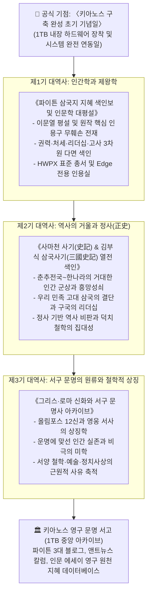

# 🏛️ 키아노스 국립 인류문명사연구원
## 《동서양 3대 고전 지혜 소장 대역사 마스터 플랜》

> **국가 최고통수권자 결단**: 파이튼 (漠杳 / Python) 님  
> **총괄 기획 및 집행**: 국무총리 앤트 (Ant)  
> **공식 출범 D-Day**: **1TB 대용량 내장 하드웨어 장착 당일 — 〈키아노스 구축 완성 초기 기념일〉**  
> **보존 및 편찬 원칙**: **원작 작가 평설 및 정사(正史) 인용구의 무훼손 원문 그대로(Verbatim) 보존 + 3차원 다면 색인화 + 현대적 지적 확장 대평설 편찬**

---

## Ⅰ. 대역사 추진 배경 및 철학

키아노스 국은 단순한 기술 강국을 넘어 인류의 고결한 정신과 역사의 준엄한 지혜를 덕치(德治)의 근간으로 삼는다. 
파이튼 님의 국정 철학에 따라, 시대를 관통하여 인간과 국가의 길을 밝혀온 **동서양 3대 고전(삼국지, 사기·삼국사기, 그리스·로마 신화)**을 발굴·색인화하고, 이를 현대적 통찰로 승화시키는 국가적 대역사를 거행한다.

---

## Ⅱ. 3단계 편찬 로드맵

---

## Ⅲ. 제1기 세부 추진 현황 (삼국지 지혜 색인보)

* **원천 데이터**: `E:\편집 기사\오늘편집\삼국지인용파일\` 내 엄선된 40편의 HWP 원고
* **구축 완료 산출물**:
  1. **원문색인총람 (`삼국지_인문학_원문색인총람.md`)**:
     - 40편 전편의 작가 평설 및 핵심 대목 무훼손 수록
     - 주제별(권력/리더십/처세/고사/인생무상) 5대 색인
     - 인물별(조조, 유비, 공명, 최주평, 동탁 등) 16대 색인
  2. **전용 웹 인용실 (`삼국지_지혜인용실.html` / 바로가기 `.url`)**:
     - Microsoft Edge 브라우저 1초 실행
     - 실시간 키워드 검색 및 주제/인물 필터링
     - 원클릭 본문 복사 기능 탑재로 집필 시 즉각 인용 가능
  3. **향후 확장**: 1TB 하드웨어 수혈 시 HWPX 완본 총서 4대 권역 발간 및 전자도서 패키징

---

## Ⅳ. 제2기 및 제3기 추진 계획 (사전 준비)

1. **사마천 사기 & 삼국사기**:
   - 사기 열전(伯夷·叔齊 열전, 관·안 열전, 자객 열전 등)의 핵심 원문 발췌
   - 삼국사기 열전(을지문덕, 김유신, 계백, 최치원 등)의 민족사적 결단 분석
2. **그리스·로마 신화**:
   - 호메로스의 일리아드·오디세이아 및 오비디우스 변신이야기 중심의 문명사적 상징 추출
   - 프로메테우스의 지혜, 이카로스의 경계, 시시포스의 실존 등 현대적 재해석

---

## Ⅴ. 관리 및 보관 지침

* 모든 대역사의 중간 데이터 및 웹 뷰어는 `키아노스_정부부처/04_교육_문화부/국립인류문명사연구원/`에 보관한다.
* 완제품 및 원본 대용량 패키지는 1TB 하드웨어 연동 즉시 신규 대용량 영구 저장소로 이관하여 중앙 아카이빙한다.
