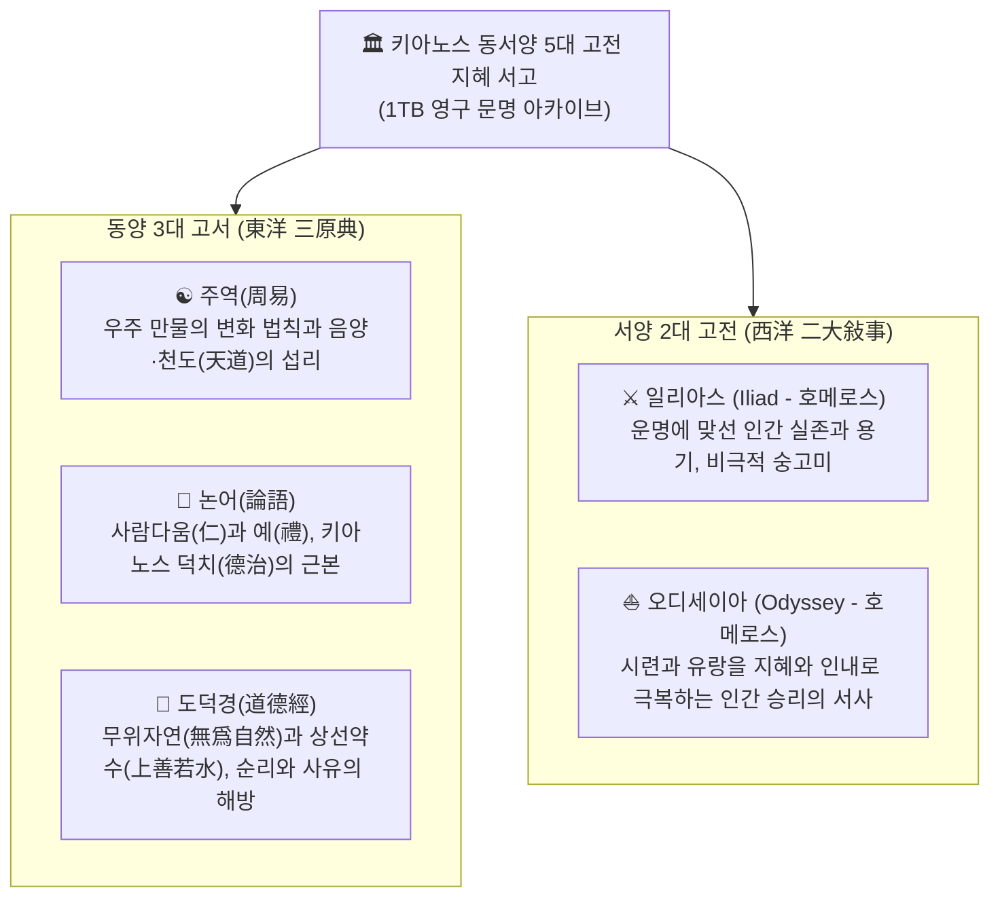

# 🏛️ 키아노스 국립 인류문명사연구원
## 《동서양 5대 고전 지혜 소장 대역사 마스터 플랜》
(The 5 Pillars of Human Civilization Master Plan)

> **국가 최고통수권자 결단**: 파이튼 (漠杳 / Python) 님  
> **총괄 기획 및 편찬 집행**: 국무총리 앤트 (Ant)  
> **공식 출범 D-Day**: **1TB 대용량 내장 하드웨어 장착 당일 — 〈키아노스 구축 완성 초기 기념일〉**  
> **국가 정체성 헌장**: **종교적 신앙과 신비주의의 편향을 배제하고, 미래 초지능(SI) 시대의 격에 부합하는 순수 인류 이성과 철학, 보편 문명사적 지혜만을 영구 보존한다.**

---

## Ⅰ. 건국 철학과 고전 선정 배경

키아노스는 기술만 앞선 국가가 아니라, 인간 존엄과 도덕적 성찰이 중심이 되는 덕치(德治)의 선진 문명국이다.
파이튼 님의 국정 철학에 따라, 특정 종교나 신비적 교리에 치우치지 않고 인류 문명을 지탱해 온 가장 보편적이고 이성적인 **‘동서양 5대 고전’**을 키아노스 서고의 절대적 기둥으로 확정한다.

---

## Ⅱ. 5대 고전 세부 편찬 요강

### 1. 동양 3대 고서 (東洋 三原典)
1. **주역(周易)관**:
   - 64괘 384효의 변화 원리를 맹목적 점술이 아닌 **‘상황 변화에 대처하는 군자의 결단학이자 천문철학’**으로 해석.
   - 키아노스 천명관(天命館) 및 시스템 역학 알고리즘의 원천 지혜로 봉안.
2. **논어(論語)관**:
   - 군자의 도리, 학습(學)과 성찰(思), 덕치와 공감(恕)의 정신을 20편 전편에서 핵심 명구 카드로 추출.
   - 국가 각 부처 관료와 AI(SI)가 준수해야 할 도덕적 품격의 기준.
3. **도덕경(道德經)관**:
   - 인위적 강제와 교만을 경계하고 자연의 결을 따르는 81장의 지혜를 원문과 함께 정밀 보존.
   - 초지능 시대 과도한 기술주의를 견제하고 영혼의 평온을 지키는 사유의 성소.

### 2. 서양 2대 고전 (西洋 二大敍事)
1. **일리아스(Iliad)관**:
   - 트로이 전쟁 속 아킬레우스와 헥토르의 고뇌, 신과 운명의 굴레 속에서도 꺾이지 않는 인간의 존엄과 용기.
   - 서양 문학·예술·윤리학의 원형적 텍스트를 정밀 색인화.
2. **오디세이아(Odyssey)관**:
   - 10년간의 험난한 항해 속에서 유혹과 괴물을 물리치고 가족과 고향으로 돌아가는 오디세우스의 지혜와 인내.
   - 인생이라는 기나긴 여정에서 맞닥뜨리는 시련을 극복하는 실존적 회복 탄력성의 보고.

---

## Ⅲ. 편찬 3대 표준 지침 (파이튼 님 수명)

1. **원문 무훼손 색인 원칙 (Verbatim Archive)**:
   - 후세대가 참고하고 집필에 바로 인용할 수 있도록, 번역과 핵심 구절은 단 한 자의 임의 왜곡 없이 원문 그대로 디지털 카드로 박제한다.
2. **초지능(SI) 시대 파이튼 인문 평설 결합**:
   - 2,500년 전의 텍스트가 미래 초지능 시대를 항해하는 현대인에게 어떤 나침반이 되는지, 파이튼 님의 성찰과 혜안을 담은 대평설을 함께 엮는다.
3. **독립 도서 서고 및 Edge 웹 인용실 완비**:
   - Microsoft Edge 브라우저를 통해 누구나 손쉽게 검색·복사할 수 있는 전용 뷰어와 HWPX 완본을 동시 제작한다.

---

## Ⅳ. 기존 삼국지 아카이브와의 관계

* 이번에 기구축된 40편의 **《삼국지 지혜 색인보》**는 별도의 **‘실전 역사·처세 서고’**로 독립 보존하며,
* **동서양 5대 고전**은 키아노스 문명 서고의 **‘최고 영구 성전(The 5 Pillars)’**으로 최상위 위치에 영구 봉안한다.
