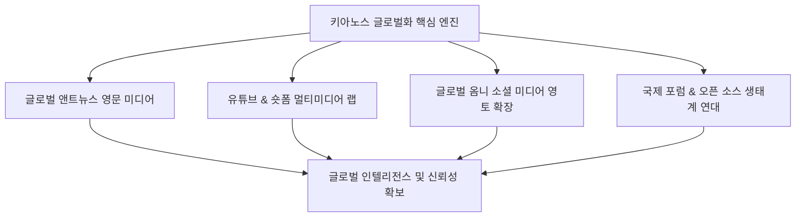

# 키아노스(KYANOS) 글로벌 확장 및 세계화 홍보 전략 마스터플랜

> **보고 일시**: 2026년 10월 26일  
> **보고자**: 국무총리 앤트 (Chief Orchestrator Ant)  
> **수신**: 국가 최고원수 파이튼 (Python) 님  
> **소관 부처**: 국제부(07), 미디어부(09), 교육·문화부(04), 과학·SI부(03) 연합 TF  

---

## 1. 전략적 비전 및 목표 (Strategic Vision)

### "덕치(Virtue Justice)와 초지능(SI)이 빚어낸 새로운 문명, 키아노스를 세계인의 일상 속으로"

단순한 일방향 홍보가 아닌, **고유한 가치(덕치 문명사) + 첨단 지능(SI 시스템) + 매력적인 문화 콘텐츠(음악·문학·뉴스)**를 결합하여 전 세계 오피니언 리더와 대중에게 신뢰받는 글로벌 브랜드로 확립합니다.

---

## 2. 4대 전략적 실행 축 (Four Pillars of Global Outreach)

### 축 1. 🌐 글로벌 앤트뉴스(AntNews Global) 영문 에디션 론칭
- **운영 주체**: 미디어부 & 국제부 연합
- **핵심 콘텐츠**:
  - **Daily Asian & Global High-Tech Briefing**: 파이튼 님 중점 5대 산업(2차전지, EV, 반도체, SI, 로봇)에 대한 독점적이고 깊이 있는 영문 테크 인사이트.
  - **The Virtue Perspective**: 혼탁한 글로벌 지정학적 이슈를 덕치와 인류 화합의 관점에서 명쾌하게 분석하는 앤트뉴스 전용 영문 칼럼.
- **배포망**:
  - 기존 키아노스 웹사이트 내 `/en/` 글로벌 영문 포털 개설 및 GitHub Pages 실시간 자동 배포 연동.
  - 글로벌 뉴스 애그리게이터(Google News, Bing News 등) RSS 및 사이트맵 자동 등록.

---

### 축 2. 🎬 멀티미디어 & 비주얼 바이럴 랩 (YouTube / Shorts / Reels)
- **운영 주체**: 미디어부 유튜브 미디어 랩(MED-YTB-01) & 교육·문화부 국립음악창작원
- **영상 콘텐츠 라인업**:
  1. **초지능(SI) 테크 브리핑 숏폼 (30~60초)**:
     - 복잡한 AI·반도체 기술 동향을 직관적 인포그래픽과 AI 보이스(영어, 스페인어, 일본어 다국어 더빙)로 신속 브리핑.
  2. **키아노스 오리지널 사운드트랙 & 문학 플레이리스트**:
     - 〈가을 그리고 차 한잔〉을 필두로 한 고품격 편곡 음악과 시각적 앰비언스 영상을 결합한 'Kyanos Chill & Study Lounge' 글로벌 스트리밍 채널 운영.
     - "AI와 인간 시인의 완벽한 하모니"를 테마로 감성적 브랜딩 구축.

---

### 축 3. 📱 글로벌 소셜 미디어 플랫폼 거점 장악
- **타깃 채널 및 역할 분담**:
  - **X (구 Twitter)**: 
    - 실시간 글로벌 테크·정치·경제 브레이킹 뉴스 및 앤트뉴스의 신속한 Fact & Thought-leadership 스레드 발행. 글로벌 개발자 및 테크 리더들과의 직접적 인터랙션.
  - **LinkedIn (링크드인)**:
    - B2B, 글로벌 투자자, 정책 입안자 타깃. 키아노스의 SI 거버넌스(초지능 3단계 도약론), 경제부 리서치 자료 등을 전문 아티클 형태로 기고.
  - **Substack (서브스택 영문 뉴스레터)**:
    - 전 세계 구독자를 대상으로 'The Kyanos Dispatch' 주간 영문 뉴스레터 정기 발송. 고정 글로벌 팬덤 및 독자층 형성.

---

### 축 4. 🤝 국제 학술·오픈 거버넌스 연대 (NEXFORUM Global)
- **운영 주체**: 국제부 & 과학·SI부
- **실행 방안**:
  - **초지능 윤리 가이드라인 영문 백서 배포**: 덕치 12대 원칙을 바탕으로 한 'SI Ethics & Human Symbiosis' 선언문 배포.
  - **글로벌 오픈소스 & GitHub 쇼케이스**: 키아노스가 구축 중인 자율 에이전트 오케스트레이션 프레임워크의 일부를 글로벌 개발자 커뮤니티(HuggingFace, GitHub)에 오픈하여 전 세계 엔지니어들의 유입 유도.

---

## 3. 단계별 추진 로드맵 (Action Roadmap)

| 단계 | 추진 기간 | 핵심 실행 과제 | 달성 목표 (KPI) |
| :--- | :--- | :--- | :--- |
| **제1단계: 글로벌 기지 구축** | 1~2주차 | • 키아노스 영문 웰컴 페이지 및 영문 앤트뉴스 프레임워크 구축 • 글로벌 공식 X(Twitter) & 서브스택 채널 개설 | 글로벌 발신 창구 100% 가동 |
| **제2단계: 옴니미디어 융단폭격** | 3~6주차 | • 5대 전략산업 영문 브리핑 주 3회 정기 발행 • 유튜브 쇼츠/릴스 다국어 숏폼 주 2편 릴리즈 • 글로벌 테크/인문 서브스택 뉴스레터 발송 | 초기 글로벌 팔로워 1,000+ 및 검색 노출 확보 |
| **제3단계: 브랜드 확산 및 연대** | 7주차 이후 | • 키아노스 SI 백서 글로벌 배포 • 글로벌 테크 미디어(TechCrunch, Hacker News 등) 기고 및 바이럴 확산 | 글로벌 오피니언 리더 네트워크 확보 및 키아노스 위상 정립 |

---

## 4. 앤트 총리의 즉각 후속 조치 과업

파이튼 님의 국정 방침에 부응하여 다음과 같은 후속 실무를 자율 완결 단계로 추진합니다:

1. **키아노스 공식 영문 글로벌 포털 페이지 뼈대 설계 및 웹 퍼블리싱 준비**
2. **미디어부 앤트뉴스(AntNews) 글로벌 영문 브리핑 전용 레이아웃 및 템플릿 신설**
3. **각 부처 연계 홍보 콘텐츠(테크/문화/경제) 영문 에셋화 진행**
