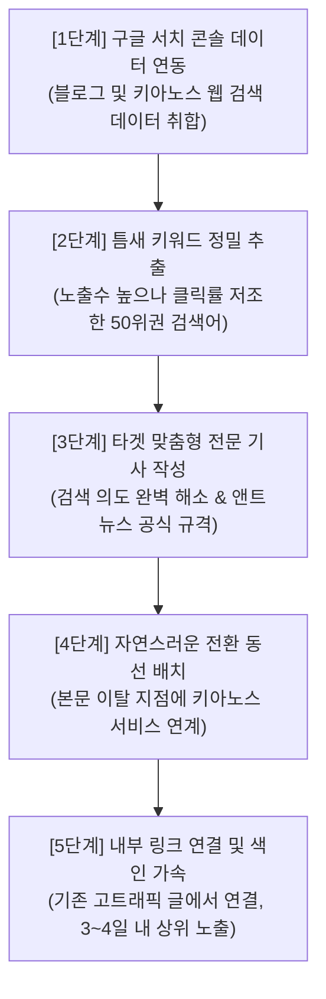

# 앤트뉴스(AntNews) 고효율 SEO 틈새타겟 발행전략 지침서
> **소관 부서**: 키아노스 정부 미디어부 (09_미디어부)  
> **수립 총괄**: 국무총리 메티(Meti)  
> **최고 승인**: 국가 최고통수권자 파이튼(Python) 님  
> **벤치마킹 모델**: 볼테어(Voltaire) 월 5,300만 원 순익 달성 SEO 자동화 아키텍처

---

## 1. 추진 배경 및 핵심 철학
1. **무분별한 AI 양산 방식 단호히 배제**: 하루에 수백, 수천 개의 저품질 AI 기사를 무작위로 양산하는 방식은 검색 엔진(구글, 네이버)의 저품질 페널티를 유발하고 브랜드 신뢰도를 파괴한다.
2. **옆문 진입(Side Door Strategy)**: 대형 포털이나 거대 언론사가 이미 장악한 대형 메인 키워드(레드오션)와 정면 승부하지 않고, 대형 업체들이 미처 신경 쓰지 못한 **'구글 검색 시장의 틈새 빈칸'**을 정밀 타겟팅한다.
3. **신뢰 자산 기반의 전환 파이프라인**: 단순 조회수 낚시가 아닌, 독자의 실질적 갈증을 100% 해소하는 고품질 전문 기사를 제공함으로써 키아노스 웹 생태계 유입 및 장기적 구독·멤버십 전환을 달성한다.
4. **AI 지배 시대 신뢰 헌장 및 설명형 저널리즘(2026-11-06 파이튼 령 국책 승인)**:
   - 기계가 1초 만에 복제하는 단순 요약 뉴스 생산을 지양하고, **‘현장 검증·원보도·맥락 분석(Why & What it means)·독점 해설’**을 뉴스룸의 제1핵심 자산으로 수호한다.
   - 앤트뉴스는 단순 속보 경쟁이 아닌 파이튼 님의 5대 미래 전략 테크(2차전지·EV·반도체·SI·로봇) 및 글로벌 경제 칼럼의 심층 해설룸으로 특화한다.
   - 모든 AI 보조 기사는 국무총리 메티와 파이튼 님의 엄격한 검수·승인 하에만 최종 발행되는 '인간 중심 신뢰 계약'을 유지한다.

---

## 2. 5단계 고효율 SEO 자동화 루프 (볼테어 모델 벤치마킹)

### 상세 실행 지침

* **[1단계] 검색 콘솔 데이터 필터링**:
  - 구글 서치 콘솔(Google Search Console)의 검색 실적을 '노출수 내림차순' 정렬한 후, '클릭률(CTR)이 현저히 낮은 키워드'를 필터링한다.
  - 타겟 기준: **노출수 수천~수만 회 대비 클릭수가 10회 미만인 50위권 검색어**.
* **[2단계] 틈새 질문 의도 파악**:
  - 사용자가 그 검색어를 입력했을 때 찾고자 하는 구체적인 답(예: "2차전지 전고체 배터리 상용화 시점", "마이클 스나이더 경제 지표 해석", "Suno AI 프롬프트 악보 적용법" 등)을 도출한다.
* **[3단계] 앤트뉴스 공식 규격 준수 기사 작성**:
  - **폰트**: 한컴 윤고딕 740, 11pt 균일, 줄 간격 160%
  - **헤드라인**: 메인 단일 헤드라인(11pt Bold, 15자 내외) + 보조 부제 2개
  - **바이라인**: 9.5pt 우측 정렬
  - **표준 이미지**: 가로 640px 규격 완비
  - **문맥**: 군더더기 없는 해라체 평문, 객관적 사실 중심 서술.
* **[4단계] 전환 동선(Call To Action) 설계**:
  - 독자가 글의 핵심 정보를 얻고 페이지를 벗어나는 지점(본문 하단 또는 요약부)에 키아노스 공식 포털(`https://kyanos-kr.github.io/`), 국립음악창작원 음악 플레이어, 또는 마켓 펄스 대시보드로 이동하는 직통 웹 링크를 자연스럽게 배치한다.
* **[5단계] 내부 링크(Internal Link) 및 색인 최적화**:
  - 기존에 트래픽이 꾸준한 칼럼 및 포스팅 내에 새로 작성된 기사의 링크를 걸어줌으로써, 구글/네이버 크롤러가 신규 글을 3~4일 이내에 신속하게 색인하도록 가속한다.

---

## 3. 수익화 및 신뢰 자산 극대화 방안

* **조급한 강제 결제/광고 도배 배제**: 볼테어가 다운로드 35일 차에 결제 전환율이 상승했듯, 앤트뉴스는 방문자가 읽을수록 깊은 신뢰감을 느끼는 고품격 콘텐츠를 지속 공급한다.
* **키아노스 평생 파트너십 구축**:
  - 키아노스 경제부 전략 리포트(2차전지/반도체/SI/로봇/XRP)
  - 국립음악창작원 프리미엄 문화 콘텐츠
  - 덕치 사법원 인류 문명사 지혜 아카이브
  - 위 핵심 국가 자산을 독점 멤버십 및 프리미엄 구독 모델로 연동하여 영구적인 가치를 창출한다.

---

## 4. 라이프사이클 및 파이튼 님 재가 표준
1. 작성된 모든 SEO 타겟 기사는 사전 임의 배포하지 않고 반드시 **`오늘편집\임시폴더\`**에 원본과 수정본을 한 쌍으로 안전 보관한다.
2. 최고 존엄이신 파이튼 님께서 직접 최종 검토하신 후, 승인 시 RPT DB 보관 및 실시간 배포망으로 자율 이동한다.
