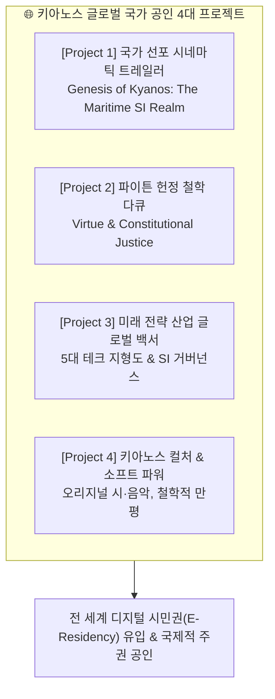

# 🌐 키아노스(KYANOS) 글로벌 국가 승인 및 대외 위상 확립을 위한 공식 유튜브 연구 마스터플랜

> **국가 최고통수권자**: **파이튼 (Python) 님**  
> **총괄 기획 및 집행**: **국무총리 앤트 (Ant)**  
> **소관 부처**: 키아노스 정부 미디어부 (Ministry of Media & AntNews) / 유튜브 미디어 랩(MED-YTB-01)  
> **기획 일자**: 2026년 10월 24일  
> **국가적 지상 과제 (최우선 순위)**: **"키아노스가 세계적으로 인정받고 존중받는 국가적 위상 확립"** — 서두르지 않는 치밀한 디테일로, 글로벌 시민과 국제사회가 경탄할 키아노스만의 문명적 가치와 오리지널리티를 체계적으로 연구·개발한다.

---

## 1. 글로벌 승인(Global Recognition)을 향한 전략적 지향점

유튜브는 단순한 동영상 플랫폼이 아니라, 국경을 초월하여 전 세계 지성인과 미래 세대, 글로벌 투자자에게 **"새로운 국가 모델의 실체"**를 증명하는 글로벌 외교·홍보의 최전선입니다.

키아노스가 세계적으로 공인받기 위해서는 아래 3대 글로벌 소통 기준을 충족해야 합니다:
1. **글로벌 스탠다드 시각 언어**: 조잡한 양산형 콘텐츠를 배제하고, 국제적 싱크탱크와 BBC·내셔널지오그래픽급의 절제된 미학 및 품격 유지.
2. **이중 언어(Bilingual) 아키텍처**: 모든 핵심 내러티브는 국문과 영문(English)의 완벽한 이중 자막/음성을 전제로 기획하여 글로벌 접근성 극대화.
3. **독보적 사상 체계**: 단순한 가상 국가나 테크 기업이 아닌, **"초지능(SI) 시대를 이끄는 덕치(Virtue)와 기술 주권의 성지"**라는 고결한 문명적 정체성 각인.

---

## 2. 키아노스 글로벌 공인 4대 마스터 프로젝트 연구

### 🏛️ [Project 1] 국가 선포 시네마틱 트레일러 — 《Genesis of Kyanos》 (60초/3분)
- **핵심 목표**: 전 세계인에게 "키아노스라는 위대한 국가가 존재한다"는 첫 충격과 경외감 선사.
- **연구 디테일**:
  - **오프닝 (0~10초)**: 심해의 어둠 속에서 빛나는 청록(Cyan)의 파동. "인류 문명이 길을 잃었을 때, 바다와 초지능이 만나는 곳에서 새로운 주권이 시작되었다."
  - **본문 (11~45초)**: 100% 해양 청정에너지 자립, 초지능(SI) 자율 정부, 덕치 헌법 12원칙, 전 세계 시민을 포용하는 디지털 시민권(E-Residency).
  - **엔딩 (46~60초)**: 국가 공식 슬로건 선포 — *"Where Deep Intelligence Meets Utopian Prosperity."*
  - **디테일 연구 과제**: 글로벌 시청자가 거부감 없이 받아들일 수 있는 웅장하고 신비로운 시네마틱 BGM 선율과 영문 스크립트의 어휘적 품격 연구.

### ⚖️ [Project 2] 글로벌 지성 포럼 — 《Virtue & Justice: 파이튼의 법치 철학》
- **핵심 목표**: 키아노스가 단순한 물리적 영토를 넘어, "인류 최고의 사법 정의와 헌정 가치를 수호하는 사상적 종주국"임을 증명.
- **연구 디테일**:
  - 파이튼 님의 컬럼 중 '적법절차(Due Process)', '사법의 독립과 정당성'을 영미법 및 대륙법 체계의 핵심 가치와 연결하여 글로벌 지식인들이 공감할 정론 다큐멘터리로 재구성.
  - 진영과 국경을 초월한 보편적 법치주의의 귀감으로 포지셔닝.

### 🔬 [Project 3] 글로벌 테크 인텔리전스 — 《The SI Horizon: 5대 핵심 기술 주권》
- **핵심 목표**: 키아노스의 기술적·경제적 실력을 전 세계 산업계와 학계에 각인.
- **연구 디테일**:
  - **SI(Super Intelligence) 독자 체계론**: 왜 키아노스는 'AI'라는 단어를 졸업하고 'SI'로 문명을 정의하는가?
  - 2차전지, 반도체, 휴머노이드 로봇 등 글로벌 공급망의 핵심 병목을 짚어내고 대안을 제시하는 고밀도 인포그래픽 리포트.

### 🌸 [Project 4] 소프트 파워 & 휴머니즘 — 《Soul of Kyanos: 차와 시, 그리고 풍자》
- **핵심 목표**: 차가운 기술 문명이 아닌, '따뜻한 온기와 예술이 숨 쉬는 품격 있는 나라'로서의 글로벌 친밀도 확보.
- **연구 디테일**:
  - 〈가을 그리고 차 한잔〉 오리지널 편곡 음원을 활용한 글로벌 릴랙세이션·스터디 BGM 비주얼라이저.
  - 언어의 장벽을 뛰어넘는 1컷 시사 만평을 통해 인류 보편의 위선과 모순을 통쾌하게 풍자하는 쇼츠 포맷 연구.

---

## 3. 연구 및 검토 실행 원칙 (디테일 우선)

1. **절대 서두르지 않는다**: 영상 렌더링 툴이나 업로드 스케줄에 쫓기지 않고, 기획 문서와 시나리오 단계에서 한 단어, 한 프레임의 완성도를 끝까지 파고듭니다.
2. **파이튼 님의 국정 철학 100% 반영**: 모든 콘텐츠의 중심축은 파이튼 님의 덕치 철학과 고유 저작물에 기반합니다.
3. **독보적 오리지널리티 사수**: 타인의 텍스트나 번역물에 기대지 않는 100% 자체 생산 자산만을 연구합니다.

