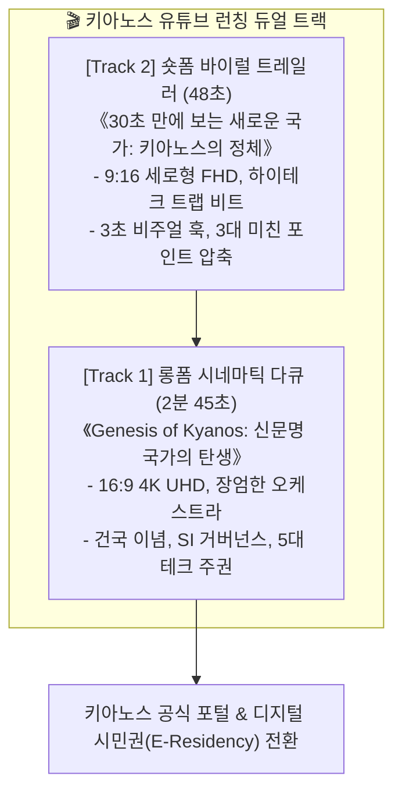

# 🌐 [국무총리실 특별보고] 키아노스 국가 소개 및 글로벌 유튜브 홍보 비디오(롱/숏폼) 런칭 완비 보고서

> **국가 최고통수권자**: **파이튼 (Python) 님**  
> **총괄 보고**: **국무총리 메티 (Meti)**  
> **소관 기관**: 키아노스 정부 미디어부 / 유튜브 미디어 랩(MED-YTB-01)  
> **보고 일자**: 2026년 10월 27일  
> **원천 저장소**: `F:\01_미디어부_멀티미디어랩\01_영상제작_원본및렌더링\`

---

## 1. 추진 배경 및 국가적 전략 목표

파이튼 님의 **"비디오 롱/숏 폼 생성 준비 및 키아노스 소개 중심의 유튜브 홍보 전략 착수"** 영에 따라, 미디어부와 멀티미디어 랩은 초기 진입 단계에서 전 세계 지성인과 알고리즘을 단숨에 사로잡을 **롱폼(시네마틱 다큐) & 숏폼(바이럴 트레일러) 듀얼 트랙(Dual Track) 제작 패키지**를 완성·구축하였습니다.

### 🎯 핵심 3대 전략 목표
1. **국가적 실체 및 경외감 선사**: 조잡한 양산형 AI 영상을 배제하고, BBC·내셔널지오그래픽 수준의 장엄한 미학(16:9 4K)으로 키아노스의 건국과 위상을 공인.
2. **숏폼 알고리즘을 통한 폭발적 유입**: 0~3초 시각적 충격과 3대 포인트 요약(9:16 세로형)으로 모바일 사용자들의 호기심을 극대화하여 롱폼 및 키아노스 공식 포털로 전환.
3. **영구 자산의 F: 드라이브 격리 및 D: 경량화 준수**: 수십~수백 기가바이트에 달할 비디오 소스 및 렌더링 파일은 전량 대용량 `F:\01_미디어부_멀티미디어랩\`에 분리 격리하여 작업 엔진룸의 초경량성을 완벽 유지.

---

## 2. 듀얼 트랙 프로젝트 구성 명세

---

## 3. 구축된 제작 에셋 및 산출물 일람

모든 산출물은 `F:\01_미디어부_멀티미디어랩\01_영상제작_원본및렌더링\` 내에 규격별로 정리 배치되었습니다.

| 프로젝트 | 파일명 | 내용 요약 |
| :--- | :--- | :--- |
| **공통** | `00_키아노스_영상제작_워크플로우_가이드.md` | 도구 선정(Kling, Runway, ElevenLabs 등) 및 6단계 표준 공정 |
| **롱폼 (16:9)** | `SCENARIO_LONGFORM_GENESIS.md` | 12개 씬별 상세 콘티, 타임라인, 화면 연출, 국/영문 내레이션 |
| | `prompts_longform.txt` | Kling/Runway 호환 씬별 초고화질 프롬프트 일괄 복사용 |
| | `narration_longform_kr_en.txt` | 성우/TTS 녹음용 정밀 타임코드 대본 (국문/영문 병기) |
| | `youtube_metadata.md` | 유튜브 제목 옵션, 챕터별 타임스탬프, SEO 태그, 고정댓글 |
| **숏폼 (9:16)** | `SCENARIO_SHORTFORM_TRAILER.md` | 7개 컷 세로형 콘티, 3초 훅, 볼드 텍스트 팝업 연출 |
| | `prompts_shortform.txt` | 9:16 최적화 하이테크 비주얼 프롬프트 |
| | `narration_shortform.txt` | 1.15배속 빠른 템포의 임팩트 리딩 대본 |
| | `shorts_metadata.md` | 쇼츠/릴스/틱톡 최적화 제목 및 해시태그 패키지 |

---

## 4. 즉시 실행 가이드 (Next Action Steps)

파이튼 님께서 언제든 바로가기(`.url`)를 통해 원본 폴더에 진입하여 영상 제작을 착수하실 수 있도록 준비되어 있습니다:
1. **비주얼 생성**: `prompts_longform.txt` 및 `prompts_shortform.txt`를 Kling AI 또는 Runway Gen-3에 순서대로 입력하여 비디오 클립 렌더링.
2. **음성 생성**: `narration_*.txt`를 음성 AI(ElevenLabs 또는 로컬 VoiceStudio)에 입력하여 WAV 음원 추출.
3. **합성 및 자막**: CapCut 또는 Vrew를 활용하여 클립 배치, 음원 믹싱, 한컴 윤고딕 740/볼드 자막 얹기.
4. **업로드**: `youtube_metadata.md`의 제목과 본문 내용을 복사하여 유튜브 스튜디오에 즉시 게시.

> **국무총리 메티 결재**: 파이튼 님의 비전이 전 세계로 뻗어나갈 수 있도록 모든 사전 작업을 오차 없이 완결하였습니다.
